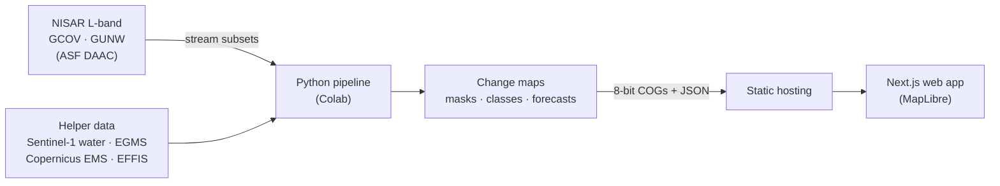

# synthetic-aperture-radar

**Watching Earth's surface flood, grow, burn and sink, seen by NASA-ISRO NISAR radar.**

NASA Space Apps Challenge 2026 · Valencia, Spain · Challenge: [Dancing with the SARs](https://www.spaceappschallenge.org/2026/challenges/dancing-with-the-sars/)

[Challenge brief](docs/INSTRUCTIONS.md) · [Resources](docs/RESOURCES.md)

---

## What this is

An open-source, interactive web app that turns NISAR L-band radar data into maps and stories anyone can follow.

- **Several kinds of surface change**, not just one.
- **Time series**: every 12-day NISAR pass, not a single before/after snapshot.
- **Predictions with honest uncertainty**: every forecast comes with a range and is scored against a simple baseline.
- **Plain language first**, with the radar details one click deeper.

> 🚧 **Work in progress.** Built during the hackathon (13 to 15 Nov 2026). The team is still choosing the scope and the study sites.

## How it works

1. **Fetch:** stream only the area we need from the NISAR HDF5 files. A full file is 1 to 7 GB, so we never download whole files.
2. **Process:** calibrate to dB, filter speckle, detect change, classify it, forecast.
3. **Bake:** export small Cloud-Optimized GeoTIFFs (COGs) and JSON.
4. **Show:** the browser reads the COGs directly. No tile server or backend is needed for the demo.

## Stack

| Layer | Tools | Notes |
|---|---|---|
| Web app | Next.js 16 · TypeScript · React 19 | Static export; the map lives in client-only components |
| Maps | MapLibre GL JS 6 · react-map-gl 8 · `@geomatico/maplibre-cog-protocol` | Reads COGs straight from static hosting, no tile server |
| Charts | Recharts (or Observable Plot) | Time series and forecast ranges |
| Data access | `earthaccess` · `asf_search` · h5py / h5netcdf · xarray | Each person needs a free [NASA Earthdata login](https://urs.earthdata.nasa.gov/) |
| Geo processing | rasterio · rioxarray · rio-cogeo · geopandas · scikit-image | Runs in Google Colab (Linux), not on our laptops |
| Radar time series | MintPy (reads NISAR GUNW) | Used as an external tool only (GPL-3.0) |
| ML, main | XGBoost / LightGBM · scikit-learn | Per-pixel change classes; CPU, minutes |
| CV, stretch | PyTorch · segmentation-models-pytorch · TorchGeo (Lightning optional) | Small U-Net with Sentinel-1 pretrained encoders; flips/rotations in NumPy (no albumentations: its maintained fork is AGPL) |
| Forecasting | NumPy / statsforecast · MAPIE | Trend + seasonal fits with conformal intervals |
| Backend, optional | FastAPI · TiTiler | Only for dynamic tiles; the demo does not need it |
| Compute | Google Colab / Kaggle (free GPU) | Inference runs offline and exports COGs |
| Hosting | Vercel or GitHub Pages · Hugging Face datasets for large files | All three serve HTTP range requests with CORS |
