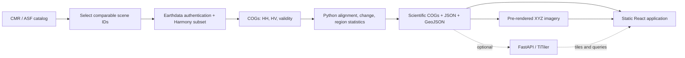

# Implementation and data recipe

Proposed plan, researched **13 November 2026**. Read [RESEARCH.md](RESEARCH.md) for the product recommendation, alternatives, and source rationale. This document describes the intended implementation; no imagery analysis or application has been built as part of the research task.

## 1. Establish the first real data example

Spend the first **60–90 minutes** on data access and interpretation. This is a proposed time box, not a runtime estimate.

Use the Albufera discovery box `[-0.50, 39.10, -0.20, 39.50]` in west/south/east/north order. Start analysis with a smaller **10 × 10 km** crop containing part of the lake and adjacent rice fields, selected after footprint and validity inspection. The discovery box also contains sea and other land; it is not the final statistical region.

Initial candidate scenes:

| Role | Acquisition, UTC | CMR granule | HDF5 science file bytes |
| --- | --- | --- | ---: |
| Earlier | 10 Sep 2026, 18:53:18 | `G4309933434-ASF` | 1,509,949,440 |
| Intermediate | 22 Sep 2026, 18:53:18 | `G4322445162-ASF` | Not separately checked in detailed metadata |
| Later | 4 Oct 2026, 18:53:18 | `G4345394349-ASF` | 1,514,143,744 |

Exact endpoint identifiers:

```text
NISAR_L2_PR_GCOV_030_066_D_069_2005_DHDH_M_20260910T185318_20260910T185353_P05023_N_F_J_001
NISAR_L2_PR_GCOV_032_066_D_069_2005_DHDH_M_20261004T185318_20261004T185353_P05023_N_F_J_001
```

Both detailed records specify provisional GCOV, stack `066_D_069`, HH/HV polarizations, primary bandwidth 20 MHz, secondary bandwidth 5 MHz, product version `1.0.11`, and processing release `P05023`. Metadata source: [earlier granule](https://cmr.earthdata.nasa.gov/search/concepts/G4309933434-ASF.umm_json), [later granule](https://cmr.earthdata.nasa.gov/search/concepts/G4345394349-ASF.umm_json). Copies are retained in [research/](research/README.md).

The file sizes above are the science HDF5 assets, not the combined size of all browse/QA assets in the legacy CMR `granule_size` field. They explain why subsetting is preferable.

### Fastest access route: Earthdata Search and Harmony

1. Sign into [Earthdata](https://urs.earthdata.nasa.gov/) on the data-processing machine. Keep credentials in the user's local authentication setup, outside the repository and browser app.
2. Open the [provisional GCOV collection](https://search.earthdata.nasa.gov/search/granules?p=C2854338529-ASF), apply the AOI and dates, and add the two exact candidate granules to a project.
3. Choose **Customize Download**, select the variables below, and enable trimming to the spatial constraint.
4. Export GeoTIFF/COG, retaining native projection or selecting **WGS84 / UTM zone 30N (`EPSG:32630`)** for the Albufera analysis. Still verify both outputs have the same grid origin, bounds, and pixel spacing.
5. Save the source granule IDs, selected variables, AOI, projection, and processing options with the outputs. Read the original QA summary/report, and retain source metadata needed to interpret the mask.

Harmony documents variable extraction, spatial subsetting, and supported projection choices. The variables menu lists all possible layers, so a selected but absent layer can be silently omitted; verify which files actually arrive. [Harmony instructions](https://nisar-docs.asf.alaska.edu/harmony/)

Select the relevant layers under:

```text
/science/LSAR/GCOV/grids/frequencyA/
  HHHH
  HVHV
  mask
  numberOfLooks
```

Use the two intensity layers plus validity and QA information. **The GCOV mask is not a flood mask.** Decode its documented values/flags and inspect fill values and metadata; do not assume `mask == 0` means valid. The official guide describes the layers and links the detailed product specification. [GCOV layer definitions](https://nisar-docs.asf.alaska.edu/gcov/)

Expected output: small georeferenced intensity subsets that open correctly in QGIS, with a visible lake, recognizable surrounding land, and substantial common valid coverage on both dates. Plot the two dates using identical display ranges.

### Programmatic discovery

This is a suggested `earthaccess` example, not an authenticated integration executed during research:

```python
import earthaccess

results = earthaccess.search_data(
    short_name="NISAR_L2_GCOV_PROVISIONAL_V1",
    bounding_box=(-0.50, 39.10, -0.20, 39.50),
    temporal=("2026-09-10T00:00:00Z", "2026-10-04T23:59:59Z"),
    count=100,
)

for result in results:
    granule_id = result["umm"]["GranuleUR"]
    print(granule_id)
    # Retain exact selected IDs after checking metadata and QA.
```

Discovery requires no login. For later downloads, authenticate with `earthaccess.login()` in the processing environment. Do not immediately download every returned file: first select the scene IDs and subset through Harmony, or use a validated streaming workflow. [Earthaccess access patterns](https://nisar-docs.asf.alaska.edu/earthaccess/)

The official ASF alternative accepts `dataset='NISAR'`, `processingLevel='GCOV'`, and `dataMaturity='PROVISIONAL'`; it can also select exact granule IDs. [ASF Search guidance](https://nisar-docs.asf.alaska.edu/asf-search/)

### If Harmony is unavailable

Use authenticated HTTPS windowed access or download just the two chosen HDF5 files if capacity permits. `h5py`/`h5netcdf` can inspect HDF5 datasets; Rasterio/GDAL can extract geospatial subsets when the appropriate driver is available. An HDF5 array read alone does not automatically create a georeferenced raster.

There is a specific GDAL compatibility trap: **before GDAL 3.13, ASF recommends the NETCDF driver for NISAR georeferencing**. Check the installed build and dataset metadata, rather than treating a successful array read as a correctly located image. Use source x/y coordinates and CRS metadata if constructing the transform manually; coordinate values represent pixel centers, so account for the half-pixel offset. [ASF GDAL guide](https://nisar-docs.asf.alaska.edu/gdal/)

HTTPS is the appropriate default from a local machine. Direct Earthdata S3 access requires compute in **AWS us-west-2** and temporary credentials. The current Earthaccess guidance specifies the NISAR endpoint `https://nisar.asf.earthdatacloud.nasa.gov/s3credentials`; the generic ASF endpoint is not interchangeable. [S3 and endpoint constraints](https://nisar-docs.asf.alaska.edu/earthaccess/)

If access fails, continue interface work with clearly labeled placeholders while solving authentication. If images are valid but contain little interpretable change, inspect other dates in the same sequence before changing the use case. A Sentinel-1 demonstration can keep development moving, but a final submission for this brief still needs an actual NISAR contribution.

## 2. Build an interpretable analysis baseline

These are proposed algorithms. Parameters and results must be established from the downloaded data and validation samples.

### A. Standardize inputs

- Keep the same sensor, product type, maturity, release, track, direction, frame, polarization, and bandwidth for the first comparison. Inspect acquisition metadata and QA for exceptions.
- Crop and align all intensity layers onto one projected grid. Work with gamma-zero **power** throughout filtering and spatial aggregation. Use an appropriate continuous-data resampling method; use nearest-neighbor for categorical masks. [Rasterio resampling guidance](https://rasterio.readthedocs.io/en/stable/topics/resampling.html)
- Build a valid-data mask from fill values, finite positive intensity, source-mask semantics, and available QA. Intersect date-specific validity for pairwise comparisons. No-data and radar shadow must not become candidate water.
- For an area time series, prefer a common valid spatial support across dates, or explicitly show coverage and qualify changing denominators. Exclude sea from land/wetland statistics using an appropriate boundary.
- Inspect lake, field, and urban control regions for shifts or artifacts. If edges move between dates, resolve the alignment before calculating change.

### B. Compute radar change before adding a classifier

For a positive diagonal GCOV power value `p`:

```text
backscatter_db = 10 * log10(p)
change_db = later_db - earlier_db
          = 10 * log10(later_power / earlier_power)
cross_to_co_db = HV_db - HH_db
```

The `10` factor follows from power units; do not use the amplitude conversion `20 * log10` on GCOV diagonal power. Mask invalid/nonpositive values before the logarithm; do not turn missing data into a small positive number.

Start with the dB difference map and per-region median HH/HV trajectories. These show an actual measured quantity even if water classification is weak. Show negative and positive changes with a fixed, labeled diverging color scale. Use fixed HH and HV display ranges through time as well.

Speckle creates apparent small changes. First inspect the multilooked GCOV data; if additional smoothing is needed, compare the unfiltered output with a modest, mask-aware filter in linear power. Document its footprint. Neighborhood operations must not bridge invalid gaps or erase narrow channels indiscriminately.

### C. Add candidate open-water mapping

1. Select lake-interior, clearly dry land, crop, and built-area samples. Obtain independent labels where possible from near-date, cloud-free optical data and local context.
2. Inspect HH/HV distributions. Start with a transparent intensity threshold calibrated to this scene and land cover. Otsu or local thresholding is an experiment, not a guarantee that a histogram separates water cleanly.
3. Combine low-backscatter evidence with the observed temporal change, source validity, land cover, and historical water occurrence. Preserve stable water as a separate class.
4. Produce classes such as **stable open water**, **candidate water gain**, **candidate water loss**, **other change**, and **insufficient observation**.
5. If removing isolated components, use a documented area threshold in square meters. Keep a raw mask for comparison; avoid deleting ecologically meaningful small water bodies.

Thresholding, change detection, and morphological filtering are established SAR flood-mapping approaches, with outcomes sensitive to preprocessing and parameters. A recent comparison is useful methodological background, but its Sentinel-1 thresholds and accuracy do not transfer automatically to NISAR. [Primary research on method sensitivity](https://nhess.copernicus.org/articles/26/2387/2026/)

Use **candidate open water** as the label unless stronger validation supports a flood interpretation. Bright flooded vegetation, wind-roughened water, wet soil, harvesting, and shadows create ambiguity. HH/HV changes can support an explanation without establishing water depth, crop health, biomass loss, or economic damage.

### D. Quantify on the analysis grid

Compute areas using projected pixel geometry, not Web Mercator display tiles or degree-valued pixels:

```text
pixel_area_m2 = abs(a * e - b * d)  # affine transform coefficients
candidate_area_ha = candidate_pixel_count * pixel_area_m2 / 10_000
```

For an axis-aligned 20 m grid, one pixel represents 400 m² or 0.04 ha. This is a geometric example, not an uncertainty estimate. Track observation coverage alongside the area. Resampling to 10 m does not create new spatial information.

For explanatory optical evidence, test `NDWI = (B03 - B08) / (B03 + B08)` or `MNDWI = (B03 - B11) / (B03 + B11)` on correctly scaled L2A reflectance. Align bands, exclude invalid/cloud/shadow pixels, and handle zero denominators. Do not treat a different-day optical mask as exact SAR-date truth. [Copernicus bands and quality layers](https://documentation.dataspace.copernicus.eu/APIs/SentinelHub/Data/S2L2A.html)

## 3. Verify the interpretation

Before presenting a numerical classification result:

- Compare held-out regions with independent optical/reference evidence. Keep threshold-tuning samples separate from evaluation samples; geographically separated regions help reduce spatial leakage.
- If suitable reference labels exist, report water precision/recall or F1/IoU, sample coverage, reference date, and known limitations. Without adequate labels, report qualitative agreement and leave accuracy unmeasured.
- Test a small range of plausible thresholds and report the corresponding area range as **parameter sensitivity**, not a confidence interval or calibrated probability.
- Inspect disagreement examples: water obscured by vegetation, dark bare ground, field transitions, and image edges.
- Reconcile measurements with physical context. Inundated rice fields can be normal management; a temporal association with rain does not establish the cause of every changed pixel.

Match the reference event and timestamp. EMSR773 is relevant to the **2024 Sentinel-1 chapter**, not ground truth for 2026 NISAR observations. A reference may also have been derived from the same source sensor; disclose that dependence.

Provisional processing artifacts are a real concern, particularly missing-data artifacts and residual interference. Read the selected scenes' QA reports and the [provisional issue notes](https://nisar-docs.asf.alaska.edu/provisional-known-issues/). A scientific product's `VALIDATED` maturity would not validate our downstream classifier.

## 4. Design the first application

The initial user journey:

1. Open Albufera with a sentence explaining why the site matters.
2. Choose a date or play the available acquisitions; show real acquisition dates and gaps.
3. Drag a before/after slider and switch between HH, HV, and radar change.
4. Select one of three prepared regions: lake interior, surrounding rice fields, or an urban/control area.
5. Read its backscatter chart, observed coverage, and any validated derived area.
6. Expand a short explanation of what the radar signal can mean, with optical/context layers and source details.

Keep measured layers available even when a classifier is uncertain. Distinguish missing observation from stable landscape. Use legends with units and text labels alongside colors. A gap between satellite acquisitions must not be animated as an observed continuous flood progression.

The difference from a generic satellite viewer should be **an explained comparison**: a selected region links map change, time-series evidence, context, and limitations. NASA Worldview already offers NISAR browsing and animation, so a map slider alone is a weak product distinction. [Existing Worldview capability](https://nisar-docs.asf.alaska.edu/tools-services-overview/)

### Architecture



The browser receives derived tiles and public result files. Keep Earthdata credentials in the processing environment. This makes a curated demonstration independent of NASA authentication and upstream processing queues during judging.

MapLibre's standard raster source consumes tiled imagery; a raw COG URL is not a drop-in XYZ tile source. For the smallest MVP, pre-render fixed-color-scale imagery to XYZ tiles, or use a small georeferenced image overlay for a limited AOI. Retain floating-point COGs for the scientific calculations. [MapLibre source specification](https://maplibre.org/maplibre-style-spec/sources/)

For tiles, current GDAL documents `gdal raster tile`; the older `gdal2tiles --xyz` route is deprecated from GDAL 3.13. Select the command supported by the locked environment. Resample categorical overlays appropriately and preserve transparency. [GDAL tiling guidance](https://gdal.org/en/stable/programs/gdal2tiles.html)

Add [TiTiler](https://developmentseed.org/titiler/) only if dynamic COG rendering is needed. Restrict it to the curated assets and cache outputs. Keep long scientific processing outside ordinary web requests. Arbitrary AOIs, persistent users, large time-series jobs, and automatic alerts belong after the demonstration.

### Proposed data contract

Use a `manifest.json` to enumerate the study area, acquisitions, layers, and derived products. Each acquisition should record:

```text
id, acquisition_time_utc, collection_short_name, source_granule_id
sensor, band, frequency, polarizations, bandwidth_mhz
track, direction, frame, maturity, crid, product_version
source_urls, retrieved_at_utc, source_checksum
analysis_crs, transform, shape, nodata, valid_coverage_fraction
layer_assets, units, display_ranges, attribution
```

For derived change/classification products, also record input IDs, common-valid mask, algorithm and version, thresholds/filtering, region definitions, and evaluation status. For each prepared region, publish median HH/HV in dB, dispersion, valid pixel count, and any derived areas with units. Do not populate uncomputed results with plausible-looking numbers.

A later API can expose `/studies`, `/studies/{id}/acquisitions`, `/studies/{id}/regions/{region_id}/series`, and raster tiles. The static version can serve equivalent JSON files without implementing those routes.

### Approximate processing scale

For a 10 × 10 km AOI on a 20 m grid, each layer has roughly 500 × 500 pixels. Two float32 intensity layers for ten dates occupy about **20 MB uncompressed**, before masks, metadata, intermediate arrays, or display tiles. This is a sizing calculation; actual subsets and transfer sizes are unmeasured.

Start with two dates, then add intermediate dates. A standard laptop should be the first target for this small crop, with actual memory and runtime measured during the spike. Full-scene or global processing is a different infrastructure problem.

## 5. Implementation order and acceptance criteria

Effort windows below are planning estimates and can overlap across team members; they are not guaranteed completion times.

| Stage | Suggested focus | Concrete acceptance criterion |
| --- | --- | --- |
| First 60–90 minutes | Data access and scene inspection | Two real NISAR subsets open in QGIS; common coverage and geolocation checked; a credible comparison selected |
| Next 3–5 hours | Analysis baseline | HH/HV and dB change COGs, validity masks, and statistics for three fixed regions; parameters recorded |
| Next 4–6 hours | Interactive application | Map comparison, dates, layer controls, chart, sources; entirely backed by real precomputed assets |
| Following 2–4 hours | Interpretation and evaluation | Independent evidence, disagreement examples, and sensitivity analysis where classification is included |
| Remaining time | Story, reliability, and submission | Reproducible instructions, attribution, public source repository, stable demo, and short pitch |

If the schedule tightens, keep HH/HV comparisons, three regions, and source transparency. Defer water classification if its validation is weak. Defer the historical 2024 chapter, live catalog search, unrestricted region drawing, predictive models, and an AI chat interface.

Meaningful implementation checks should cover real failure modes: pixel alignment, valid/no-data behavior, power-to-dB conversion, categorical resampling, and area arithmetic. Smoke-check date changes, map/chart synchronization, and missing-observation display in the finished interface. Do not invent scientific validation through UI tests.

## 6. Optional historical flood chapter

The saved [Sentinel-1 inventory](research/valencia_sentinel1_2024_catalog.json) includes repeated candidates for burst IDs:

```text
T110-234965-IW3
T110-234966-IW3
T110-234967-IW3
```

Each has acquisitions on **20 October and 1 November 2024**. Inspect footprints, valid overlap, provenance, and processing differences before pairing them. Several other returned records are duplicates or belong to different tracks. The two dates embedded in an OPERA filename represent acquisition and production; do not confuse later reprocessing with a later observation.

Use OPERA VV/VH COGs and masks, mosaic only the needed bursts on a common grid, and compare with suitable [Copernicus EMSR773 products](https://mapping.emergency.copernicus.eu/news/flood-in-valencia-region-spain/). Show residual water at the acquisition date and account for seasonal rice-field water. Do not subtract NISAR HH and Sentinel-1 VV directly as though they were interchangeable measurements.

## 7. Decisions for the team

The recommendation can proceed with the stated assumptions. Team input will refine:

- Whether Albufera seasonal change or another use case best fits the team's interests.
- Python/web experience, implementation time, and who can perform the first authenticated data extraction.
- Whether the demo prioritizes a polished curated story or more open-ended exploration.

The first decisive technical action is to acquire and inspect the two small NISAR subsets. Everything after that should follow the evidence in those observations.
