<div align="center">

# Map visualization

**How the app shows change on the map: the decisions, the screen, the 3D, the films and the storyboard.**

</div>

Written 14 Nov 2026 on branch `feat/map-viz`. This is version 2, rebuilt the same day after Ilija's review of version 1. The prototype is three pages of the web app (`web/`): `/flood`, `/fire` and `/rice`.

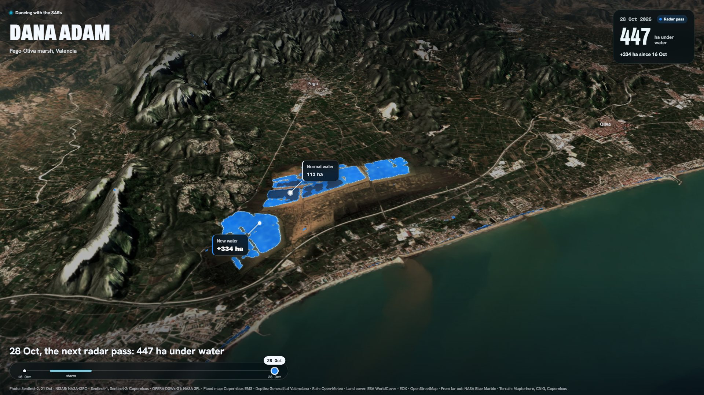

<sub>A real frame: the water NISAR mapped on 28 Oct 2026 at the Pego-Oliva marsh, on real terrain, over a real Sentinel-2 picture.</sub>

Every fact was checked that day against the source named beside it. **[data]**: I ran the query or read the file myself. **[doc]**: an agent of this session opened the page and quoted it (**[doc, rechecked]**: I opened it again). **[not checked]**: taken from another note; do not put it in a caption.

---

## 1. Why version 2

Version 1 was exact and showed every source. That is what made it hard to read. Ilija's review, in his words:

- "this is not that good ... it is off ... it doesnt feel intuitive"
- "zooming isnt really like zooming and showing what we zoom on"
- "the changes are not that clear"
- "the screen at one moment is going grey, which represents what?" It was the picture of 18 Oct, all cloud.
- "the pink lines appear, and everything is pretty unclear what happens". It was the Copernicus outline, hundreds of small shapes.
- "why is only one square there shown?" It was water from before the storm, drawn paler.
- "the grid is still the same" while he changed dates. The date buttons only swapped the photo.
- "there is too much text"
- "the menu is too big, we should give attention to the map itself, and not overwhelm the audience with all settings on screen but hidden behind buttons"
- "the most important things to be as classified and pointy as possible ... DIRECT THING we should look at and we should spot the floods"
- "no blender okay", and "lets use as much 3d things as we can"

The rules that came out of it:

1. The map gets the screen. Settings sit behind one button.
2. One loud shape, one number, one short sentence.
3. Labels on the map. No legend.
4. One control for the date.
5. A mark that needs explaining is cut, or labelled on the map.
6. A zoom shows what it zooms on.
7. As much real 3D as the data carries, inside the app. No Blender.

## 2. Decisions

| Question | Decision | Why |
|---|---|---|
| Map library | **MapLibre GL JS 6** with our own WebGL layers | Open, no token, no billing. A custom layer gets the graphics card. Terrain, globe and sky are built in. |
| A dated raster in the browser | **Frames baked once**: one lossless WebP of distance fields per pass, drawn by a shader. **No tile server.** | A shoreline can travel between passes, the picture is crisp at any zoom, and a plain file fetch works on every static host. |
| Imagery | **Real Sentinel-2 pictures, the clear ones**, over the site. **EOX cloudless 2017** around it. The **Blue Marble** from far out. | Real, dated, free. The 2017 mosaic is CC BY 4.0; the newer ones are non-commercial. |
| 3D | **Real terrain inside MapLibre**, our layers laid over it, a globe for the way in | It runs live on the real layers. Blender would be a video, and Ilija ruled it out. |
| Between passes | **Interpolated, and marked as an estimate**: one word in the readout, a dashed shoreline, a little see-through | NISAR passes every 12 days. An estimate never passes for a measurement. |
| Storm | Water **rises with the rain** and only **falls after it** | Otherwise water rose under a dry sky. |
| Fire | The scar follows **the dates of the EFFIS record** | No radar passed for 24 days. An even clock showed 3 ha twelve days after the fire started. |
| Two radars | **NISAR and Sentinel-1 are separate series**, never blended | L band and C band see vegetation differently. |
| Official maps | **One calm shape under our layer**, off until asked for | They are the check, not our data. |

## 3. What the data says about the DANA at the Pego-Oliva marsh

All times UTC, October and November 2026.

| When | What | Source |
|---|---|---|
| 8 Oct 11:00 | Sentinel-2 picture, 2.4 % cloud. The clear "before". | [data] Earth Search |
| 16 Oct 18:53 | NISAR pass, track 066 D: **113 ha** of water (CV model, sea left out) | [data] CMR, `data/cv` |
| 16 to 17 Oct | Four Sentinel-1 passes: 27 ha of open water, 375 ha of flooded vegetation on the last one | [data] OPERA DSWx-S1 |
| 18 Oct 11:00 | Sentinel-2 picture: **100 % cloud** | [data] Earth Search |
| 18 to 19 Oct | The rain. 193 mm in the weather model at the marsh, up to 27 mm in one hour | [data] Open-Meteo, AROME 1.5 km |
| 20 to 21 Oct | Copernicus EMS maps the flood from other satellites: **1,118 ha** | [data] `data/labels` (EMSR935) |
| 21 Oct 11:00 | Sentinel-2 picture: **0 % cloud**. The marsh under orange water. | [data] Earth Search |
| 22 Oct 06:09 | First Sentinel-1 pass after the storm. It saw 82 % of the site and measured 524 ha of open water there. The map shows **527 ha**: in the strip the pass missed it keeps the last state that was seen (3 ha). | [data] OPERA DSWx-S1 |
| 28 Oct 18:53 | NISAR pass, track 066 D: **447 ha** of water, 334 ha more than on 16 Oct | [data] `data/cv` |
| 28 Oct to 10 Nov | Eleven Sentinel-1 passes: open water falls to **250 ha** | [data] OPERA DSWx-S1 |
| Other NISAR tracks | 058 A on 16 and 28 Oct, 167 D on 23 Oct (63 % of the site). Nothing after 28 Oct published yet. | [data] CMR, 14 Nov |

- **Neither radar passed during the storm**: no Sentinel-1 pass from 18 to 21 Oct, no full NISAR pass between 16 and 28 Oct. So the page never says radar saw the flood through the cloud. It says "No radar pass until 28 Oct: an estimate", and the peak (the Copernicus map, 1,118 ha) is drawn as its own shape, never animated as if it were ours.
- **Sentinel-1 fills the days NISAR misses**, 18 passes in 26 days. It is the second series of the flood page.
- The rain is modelled, not gauged. Three models disagree (ERA5 73 mm, IFS 62 mm, AROME 206 mm for 15 to 24 Oct) [data]. A gauge total of 634 mm at Pego is quoted in the prediction notes [not checked].

## 4. The stack

| | MapLibre GL JS 6.18 | deck.gl 9.4 | Mapbox GL JS 3.35 | CesiumJS 1.147 |
|---|---|---|---|---|
| Licence | BSD-3-Clause | MIT | Proprietary since v2 [doc, rechecked] | Apache-2.0 |
| Token or account | None | None | Token, billed after 50,000 map loads a month | Only for Cesium ion |
| Size, minified | 1.1 MB + 0.5 MB worker | 2.1 MB | 1.9 MB | 6.1 MB |

- MapLibre 6 is ESM only and needs WebGL2. On the flat map a custom layer's `render` gets the Mercator matrix. With terrain on, MapLibre calls `renderToTerrainTile` instead (section 9) [data, read in `maplibre-gl.d.ts`].
- **Frames, not COGs in the browser.** The COG protocol for MapLibre removes and re-adds its layer on every tick, geotiff.js needs range requests, and TiTiler needs a server [doc]. COGs stay the exchange format of the pipeline: the bake reads them.
- **Hosting.** Frames are fetched whole, so any static host works. Cloudflare Pages answers range requests with a full 200 [doc, rechecked], which breaks COG readers and does not touch us. The layers weigh 12 MB for the marsh, 11 MB for the Albufera and 13 MB for Serra d'Espadà [data].

## 5. Sources, and how each is credited

| Source | Licence | Line to show |
|---|---|---|
| Sentinel-2 L2A (Earth Search STAC, no login [data]) | Free, full and open | Contains modified Copernicus Sentinel data 2026 |
| EOX cloudless 2017, the base map | CC BY 4.0. The 2018 to 2025 mosaics are CC BY-NC-SA 4.0 [data, WMTS capabilities] | EOxCloudless https://cloudless.eox.at by EOX IT Services GmbH (Contains modified Copernicus Sentinel data 2017) |
| EOX overlay, names from far out | | Data © OpenStreetMap contributors, rendering © EOX and MapServer |
| Blue Marble, the Earth from far out (NASA GIBS, no key) | Open | Blue Marble: NASA Earth Observatory, served by NASA GIBS |
| Terrain: Mapterhorn tiles, no key | Data: in Spain MDT02 of the national survey, CC BY 4.0; elsewhere Copernicus GLO-30 [doc]. No terms found for the hosted endpoint [doc]. | Terrain: © Mapterhorn (mapterhorn.com/attribution). MDT02 2015-2021 CC-BY 4.0 scne.es; Copernicus GLO-30, DLR e.V. 2010-2014 and Airbus Defence and Space GmbH 2014-2018, provided under COPERNICUS by the European Union and ESA |
| ESA WorldCover 2021, land cover | CC BY 4.0 [doc] | © ESA WorldCover project 2021 / Contains modified Copernicus Sentinel data (2021) processed by ESA WorldCover consortium |
| OPERA DSWx-S1 (PO.DAAC) | Open | OPERA Dynamic Surface Water Extent from Sentinel-1, version 1 (NASA JPL, PO.DAAC), plus the Copernicus line |
| NISAR GCOV (ASF DAAC) | Open, citation urged | NASA-ISRO NISAR, NASA ASF DAAC |
| Copernicus EMS EMSR935 | Free, full and open | Copernicus Emergency Management Service, EMSR935 |
| EFFIS burnt areas | CC BY 4.0 | Burnt areas: EFFIS, © European Union |
| Measured depths | [not checked] | Generalitat Valenciana, Servicio de Gestión de Riesgos en el Territorio |
| Open-Meteo, rain | CC BY 4.0, free tier non-commercial | Weather data by Open-Meteo.com |

- A short credit line is always on screen. The full list is behind Layers, Sources.
- No NASA logo, insignia or mission mark anywhere: NASA allows factual use and a text credit, not the marks [doc].
- The storm picture from space that version 1 opened on is gone. A sky full of cloud does not show where the zoom is going.

## 6. The screen

One component, `web/src/components/flood/story-app.tsx`, draws all three pages. A story is one object in `web/src/content/stories.ts`.

| Where | What |
|---|---|
| Top left | The switch between stories: **Flood**, **Fire**, **Not a flood** (the rice season). Under it the title and the place. |
| Top right | The date. One word: **Radar pass** or **Estimate**. One number with its unit. One line under it: "+334 ha since 16 Oct", "EU map: 9,222 ha", "+4,953 ha of farm water". |
| On the map | Up to four labels: a dot on the thing, a short line, a title and a value ("New water +334 ha"). A few town names. From far out, one pin on the place. |
| Bottom left | One short sentence. Under it the time strip: play, one dot for each radar pass, a band for the storm or a tick for the fire, the playhead with its date. |
| Bottom right | The **Layers** button. Behind it: the radar (NISAR or Sentinel-1), the official map, Measured depth, Exact pixels, 3D terrain, the photo (Clear or Same day), day or night, Play the film, Sources. |
| Bottom edge | The credit line: the photo and its day, the sources of the story, the terrain. |

- **Labels.** Their places come from `story.json` (section 10): the point deepest inside the largest patch, so a label never falls outside its shape. What is new is counted live. Labels lean away from each other and from the edges of the screen, again whenever the camera moves.
- **One control for the date**: the strip. Drag it and it snaps onto a pass. Space plays and pauses, the arrow keys step from pass to pass.
- **The photo follows the date.** "Clear" shows the newest picture with under 12 % cloud, "Same day" the newest one whatever its cloud. The credit line names the day of the picture: under the pass of 28 Oct lies the clear picture of 21 Oct.
- **Opening.** The page comes down onto the place in 2.8 s, then plays its passes once. `?still`, and people who ask for less motion, get a still picture.
- **Film mode** (`?story`, or Play the film): the switch, the Layers button and the play button go. Escape leaves it.
- **A phone** (under 720 px wide) gets the same parts, smaller.

## 7. The look of the layer

The fragment shader is `web/src/lib/water-shader.ts`. Everything it draws lives on the ground, never on the screen, so one shader draws the flat map and the terrain.

| Meaning | Look |
|---|---|
| New water (the pass before the storm did not have it) | Bright blue, almost solid, a white shoreline, a soft glow on the land side, slow light on the surface |
| Water that was already there | The same blue, deep and dark, a thin outline. Pale read as an island of land inside the flood. |
| Flooded vegetation (Sentinel-1) | A lighter blue of the same family |
| Between two passes | The shape travels. Where the two passes disagree it is 30 % more see-through and its shoreline is dashed. |
| Ground a pass did not see | A very faint grey hatch, only at a pass |
| Burn | A dark scorched fill with an ember edge. Matt: light plays on water only. |
| Official map | One pink shape, under the radar layer |
| Measured depth | Amber columns |
| Forecast (no data yet) | Stripes on the ground and a dashed outline, never a solid fill |

- The picture under the layer is dimmed, so the layer is what the eye lands on first.
- The light on the water moves about thirty times a second. People who ask for less motion get a still surface.
- A thin rim inside the shoreline is lit from the north-west, as on a printed map. It marks the edge, not depth.
- Ripples run with a moving shoreline while the series plays, and the shoreline pulses once at a pass.

**Dropped from version 1**: hatching over the fill, dots and the mint colour on flooded vegetation, the swipe, and the darker middle of a water body. That last one was styling by distance from the shore, not depth.

## 8. Animating the change

For every pass the bake (`web/scripts/bake_water.py`) writes one frame with, for each pixel, the **signed distance to the nearest shoreline** (negative in water), one field for all water and one for open water, plus a mask of what the pass saw. The shader mixes the fields of the pass before and the pass after the playhead and draws water where the mix is below zero. `web/src/lib/flood-model.ts` holds the clocks.

- **At a pass the picture is that pass.** The mix is one field alone.
- **Between passes a shoreline travels** across the ground. It is an interpolation, and the readout says "Estimate".
- **Two clocks.** A pixel on its way into the water follows the gain clock, a pixel on its way out the loss clock. In a gap with at least 15 mm of rain the gain clock follows the cumulative rain and the loss clock starts when 97 % of the rain has fallen. For NISAR between 16 and 28 Oct this gives 113 ha, then 456 ha when the rain stops, then 447 ha at the pass.
- **A fire has its own clock.** Nothing burns before its start (EFFIS: 25 Jul, 07:09 UTC) and all of it has burned by the last update of that record (26 Jul, 06:55 UTC, with 9,222 ha mapped). The hectares rise evenly in between. Then the scar stays an estimate until the next pass.
- **Far water starts in its middle.** Between passes a distance outside the water counts for at most 12 pixels (about 180 m), so new water far from any old water grows out of its deepest part and does not pop in at the last moment. The hectares between passes follow the same rule.
- Where a pass did not see a pixel, the last state that was seen is kept, so a shoreline never moves only because a pass missed it.
- **Hectares are counted on the grid of the map** (Web Mercator, about 15 m here), every pixel with its true ground area. The pipeline counts on its own 20 m grid, so the two differ by a fraction of a percent: the burn of 16 Oct is 5,340 ha on the map and 5,330 ha in the table of the CV session.

**Playback gives its time to what happens.** Flood: 0.9 s for the days before the storm, 3.2 s for the two days of rain, 1.8 s for all the days after. Fire: 1.4 s for the four passes before it, 1.5 s for the day it burns, then an even pace. Rice: 2.6 s for the months the water hardly moves, 5.2 s for the weeks it rises. Every pass holds the playhead for 0.42 s.

## 9. 3D

Everything here is `web/src/lib/scene3d.ts`, plus the two layers.

- **Terrain.** `map.setTerrain` on Mapterhorn elevation tiles (in Spain the 2 m lidar model MDT02), drawn 1.5 times taller than life. The marsh is flat; its mountains are a few hundred metres. Layers, 3D terrain switches it off.
- **Our own layers lie on it.** With terrain on, MapLibre calls `renderToTerrainTile` and not `render`. The water layer and the picture layer draw their part of each terrain tile, and MapLibre lays the tiles over the ground with its own raster, fill and line layers. The hook is marked experimental in MapLibre 6.18 [data].
- **A catch we met.** Over terrain the ground is kept as tiles, drawn again only when one of our layers says so. The official map stayed at the first, invisible step of its fade, so the page now asks for a repaint for 1.1 s while it fades in.
- **The globe and the way in.** From far out the map is a ball. MapLibre turns it flat by itself between zoom 11 and 12 [doc]. The film starts on the ball with one pin on the place and comes down in one move: the zoom runs evenly, the place drifts to the middle, the camera only tilts and turns in the last stretch. Before that the page visits the way in once behind a veil, so the flight shows sharp ground and not tiles arriving.
- **From far out** the Blue Marble lies under the base map (the EOX 2017 mosaic showed white south of about 22° N). **A sky** stands over the ground: day, night, and a darker one while it rains.
- **Measured depths as columns.** 71 points, 0.15 to 1.54 m, measured by the Generalitat [data]. Each stands 200 m tall per metre of water. The columns compare the points; they are not to scale, and Sources says so.
- **Cameras** (centre, zoom, pitch, bearing). The marsh from over the sea, looking inland: 38.87 N 0.064 W, 12.8, 58°, -110°. The burned slopes facing the camera: 39.885 N 0.262 W, 11.75, 60°, -25°. The lagoon behind its rice fields: 39.3 N 0.33 W, 11.25, 50°, -8°.
- **Frame rate** of the finished pages, headless Chrome at 1600 x 900 on a laptop graphics card (RTX 4070), production build [data]: about 143 a second at rest with the light on the water moving; 62 to 64 a second while the passes play with terrain on (95 % of the frames under 21 ms); 128 to 134 with terrain off. One frame runs long when a new picture arrives (0.1 s on the flood page, 0.3 s on the fire page). At a scale of 1 the draped shoreline was as sharp as the flat one.

**What we refuse.** No invented water depth. There is depth at 71 points and nowhere else, so there is no water volume that rises like a bath. The water is a flat sheet on real ground, which is what it is.

## 10. Story data

`web/scripts/bake_story.py` writes `web/public/layers/<site>/story.json`: the labels, the official map as one calm shape, the depths as small hexagons the map raises into columns, the clear photo days, the share inside the official map, and the land cover of what is new. It measures the frames `bake_water.py` wrote, so every figure matches `meta.json` [data].

| | Marsh (flood) | Serra d'Espadà (fire) | Albufera (rice) |
|---|---|---|---|
| Before and after | 113 ha on 16 Oct, 447 ha on 28 Oct | 0 ha on 24 Jul, 5,340 ha on 16 Oct | 2,479 ha on 24 Jul, 7,325 ha on 28 Oct |
| What the page calls new | +334 ha, the net change | 5,340 ha | +4,953 ha over the 2,371 ha that are always water |
| Official map | Copernicus EMS, 1,118 ha; drawn as 6 parts, 1,124 ha | EFFIS, 9,222 ha; drawn 9,220 ha | none |
| Share inside it | 74 % of the ground newly under water | 92 % of the burn | |
| Land cover of what is new | Cropland 291 ha, wetland 32 ha, permanent water 10 ha | Tree cover 3,605 ha, shrubland 1,442 ha, grassland 292 ha | Wetland 2,496 ha, cropland 2,328 ha |
| Photos | 8 Oct, 21 Oct | 23 Jul, 19 Aug | 30 Jun, 21 Oct |

- At the marsh 343.5 ha of ground are newly under water and 9.8 ha went dry: net +334 ha, the number on the page. The 291 ha of cropland are out of the 343.5 ha.
- The Copernicus product is 1,892 parts. Closing gaps of 40 m added a third to its area, so the calm shape closes 8 m, drops parts under 5 ha, fills holes under 2 ha and simplifies to 15 m. The share inside it is counted on the original polygons.
- The rice page does not say what its new water lies on: the land cover map calls rice fields wetland.

## 11. The films

Open a page with `?story`. First the way in loads behind a veil. Then:

**Flood** (`/flood?story`)

1. The Earth and one pin. "Valencia coast, Spain".
2. One move down onto the pin, 6.4 s. The line becomes "Pego-Oliva marsh, Valencia".
3. "Before the storm". 113 ha, label "Normal water".
4. The passes play while the camera drifts 16°. "DANA Adam: 193 mm of rain in two days (weather model)". Rain falls, the sky darkens, the water rises as an estimate.
5. "No radar pass until 28 Oct: an estimate".
6. "28 Oct, the next radar pass: 447 ha under water". Label "New water +334 ha".
7. "Most of the new water lies on farmland: 291 ha".
8. The official map fades in under the water. "EU flood map: 1,118 ha", then "74 % of what the radar found lies inside it".
9. The depth columns rise. "Measured on the ground: up to 1.54 m deep".

**Fire** (`/fire?story`)

1. The Earth and one pin. "Castelló, Spain", then "Serra d'Espadà, Castelló".
2. "Before the fire".
3. "25 Jul: the fire starts". The scar burns in as an estimate.
4. "No radar pass until 17 Aug: an estimate". The picture of 28 Jul under it still shows the smoke.
5. "17 Aug: the radar confirms 1,449 ha".
6. "Pass after pass, the radar confirms more".
7. "5,340 ha confirmed by 28 Oct".
8. "Most of the burn was forest: 3,605 ha".
9. "EU burnt area map: 9,222 ha", then "92 % of what the radar found lies inside it".

The burn is "burn the radar confirms": the echo 1.5 dB down on two passes in a row. It is about half of what EFFIS mapped, and it grows after the fire is out as more pixels pass the rule. It is not the spread of the fire.

**Rice** (`/rice?story`)

1. The Earth and one pin. "Valencia, Spain", then "Albufera, Valencia".
2. "Summer: the lagoon holds the water".
3. "Autumn: farmers flood the rice fields".
4. "28 Oct: 7,325 ha of water. Farm water, not a flood".

With Sentinel-1 chosen, the flood page says "22 Oct, the next radar pass: 527 ha of open water", then "The water goes down slowly", and ends on the 250 ha of 10 Nov.

The films were recorded from the production build with `web/scripts/record_flood.py` (the screencast of the installed Chrome, the smoothest of up to four takes at 30 to 39 frames a second): flood 26 s, fire 29 s, rice 22 s, at 1920 x 1080. They are in `web/.cache/film/`, not in git. The video of the hackathon is 30 s for everything, so they are material for the cut, not the cut.

## 12. Storyboard

Frames in `docs/storyboard/`, 1,920 px wide. All but two are **real**: screenshots of the running app on real data, from the production build (`web/scripts/shoot_flood.py`). The two **mockups** were made with an SI image model for scenes that are not built. They carry a visible watermark and every number in them is a placeholder. They were drawn before version 2, so their panels are not the ones of the pages now.

| Frame | What it shows |
|---|---|
| <a href="storyboard/01_earth.jpg">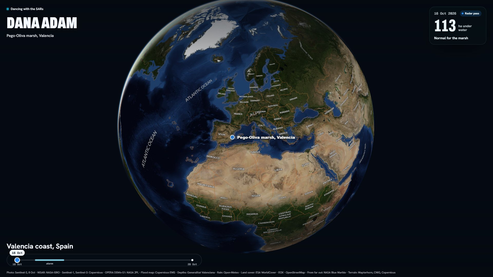</a> | **01 The Earth.** Where the film starts: the ball, and one pin on the marsh. |
| <a href="storyboard/02_before.jpg">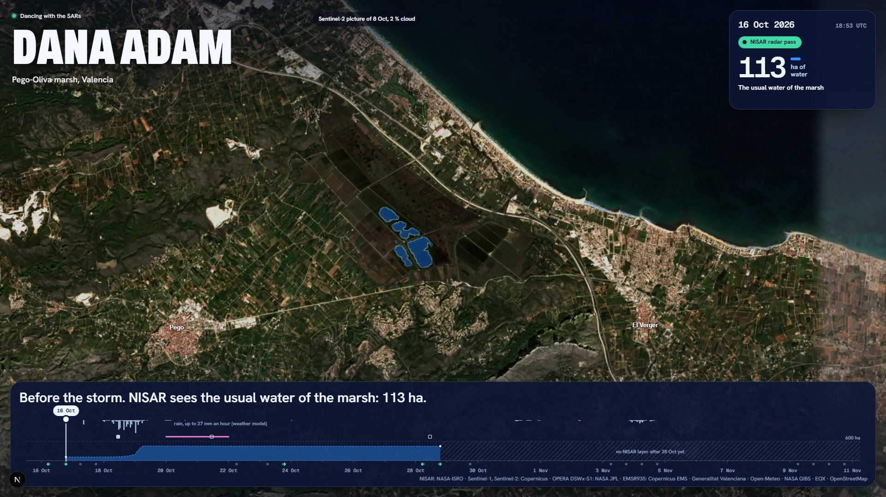</a> | **02 Before.** The pass of 16 Oct: 113 ha, the normal water of the marsh. |
| <a href="storyboard/03_storm.jpg">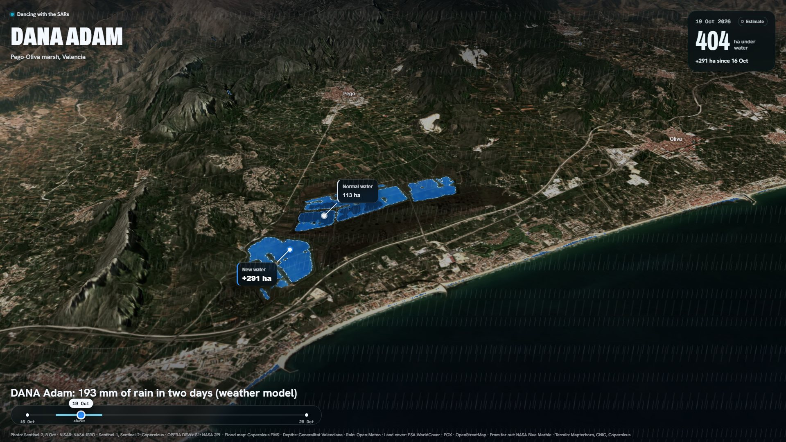</a> | **03 The storm.** 19 Oct, an estimate: rain, a dark sky, the water rising. |
| <a href="storyboard/04_after.jpg"></a> | **04 After.** The pass of 28 Oct: 447 ha, "New water +334 ha". |
| <a href="storyboard/05_official.jpg">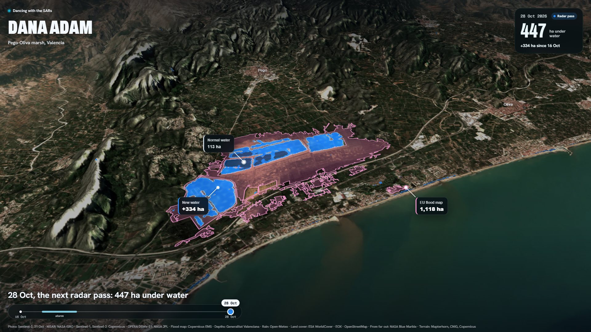</a> | **05 The check.** The EU flood map, 1,118 ha, under the radar water. |
| <a href="storyboard/06_depth.jpg">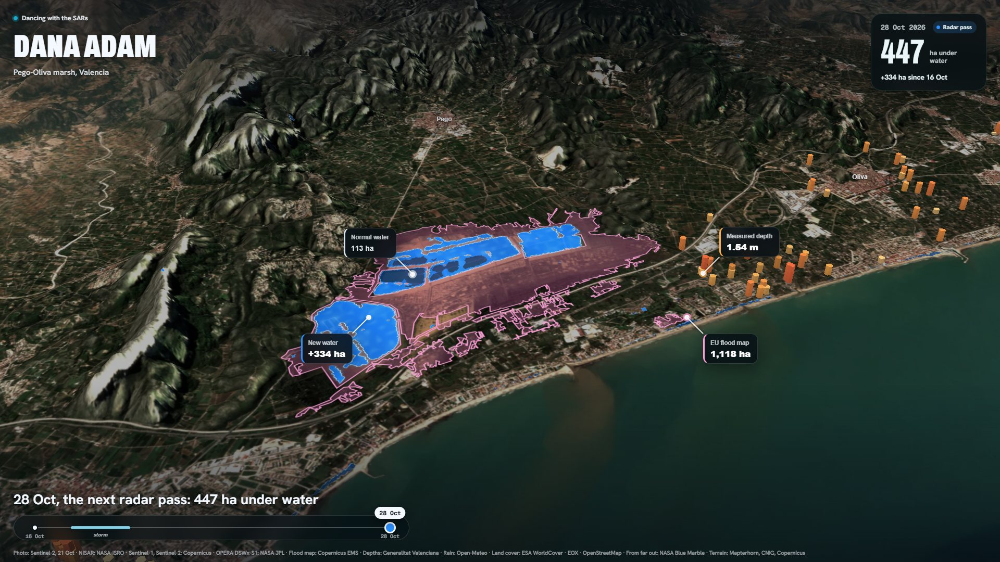</a> | **06 Depth.** The measured depths as columns, up to 1.54 m. |
| <a href="storyboard/07_fire_before.jpg">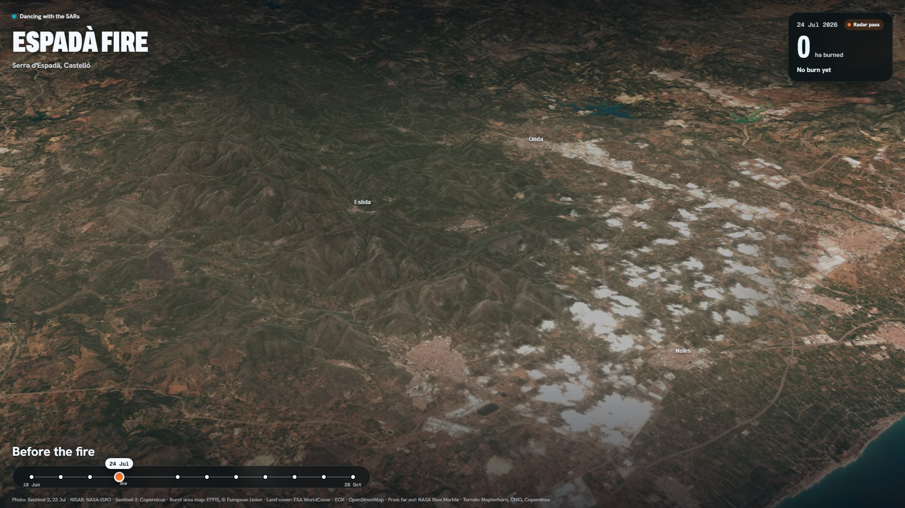</a> | **07 Fire, before.** The pass of 24 Jul: no burn. |
| <a href="storyboard/08_fire_burning.jpg">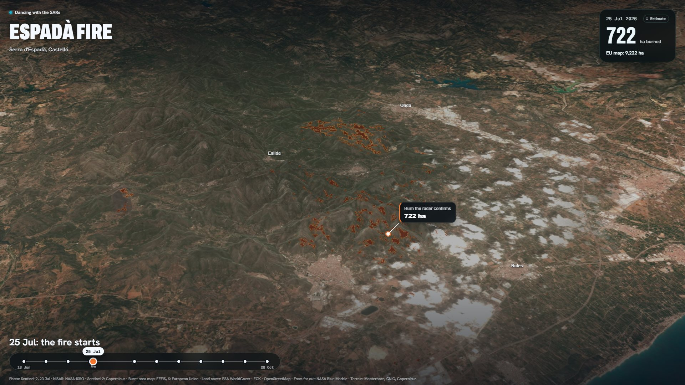</a> | **08 Fire, the day it burns.** 25 Jul, an estimate timed by the EFFIS record. |
| <a href="storyboard/09_fire_estimate.jpg">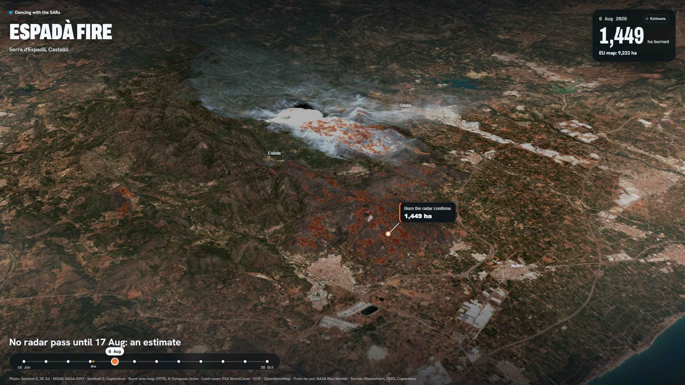</a> | **09 Fire, not seen yet.** 6 Aug: the scar of the next pass, still an estimate, over the smoke of 28 Jul. |
| <a href="storyboard/10_fire_confirmed.jpg">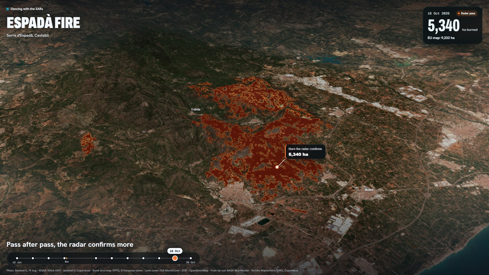</a> | **10 Fire, confirmed.** The pass of 16 Oct: 5,340 ha of burn the radar confirms. |
| <a href="storyboard/11_fire_official.jpg">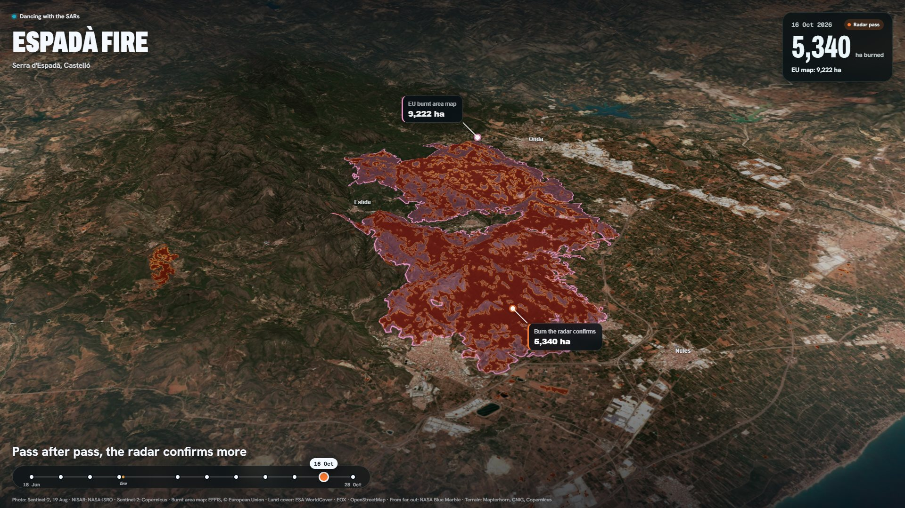</a> | **11 Fire, the check.** The EU burnt area map, 9,222 ha, under the burn. |
| <a href="storyboard/12_rice_summer.jpg">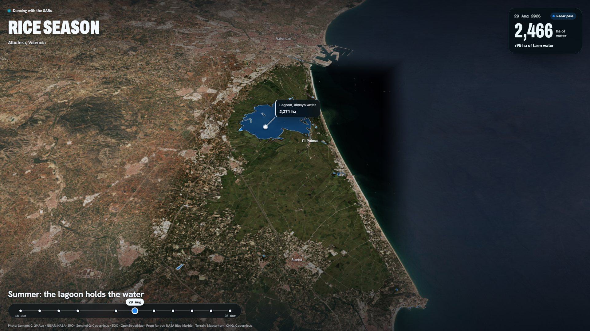</a> | **12 Rice, summer.** Only the lagoon holds water. |
| <a href="storyboard/13_rice_october.jpg">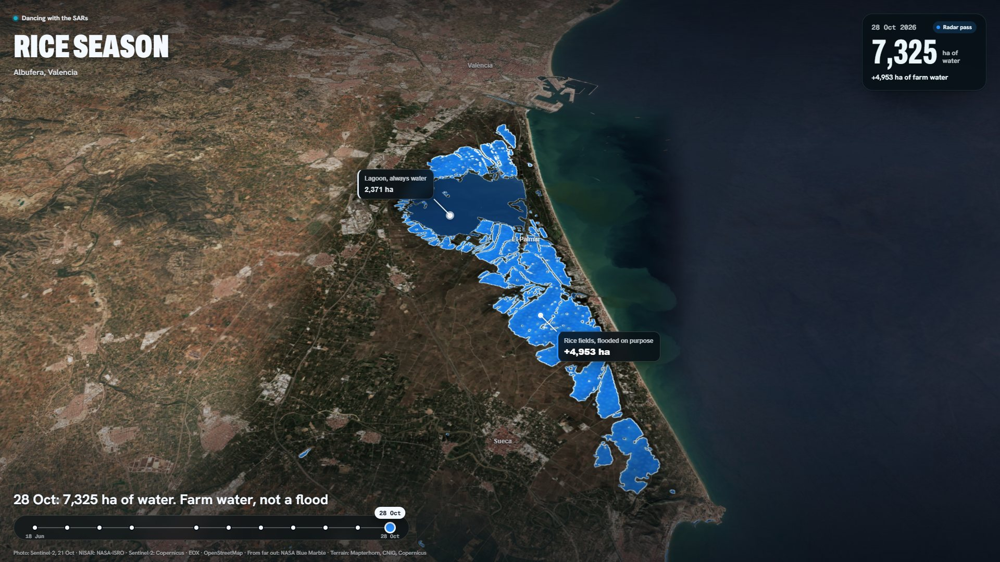</a> | **13 Rice, October.** 7,325 ha: farm water, not a flood. |
| <a href="storyboard/a1_app_menu.jpg">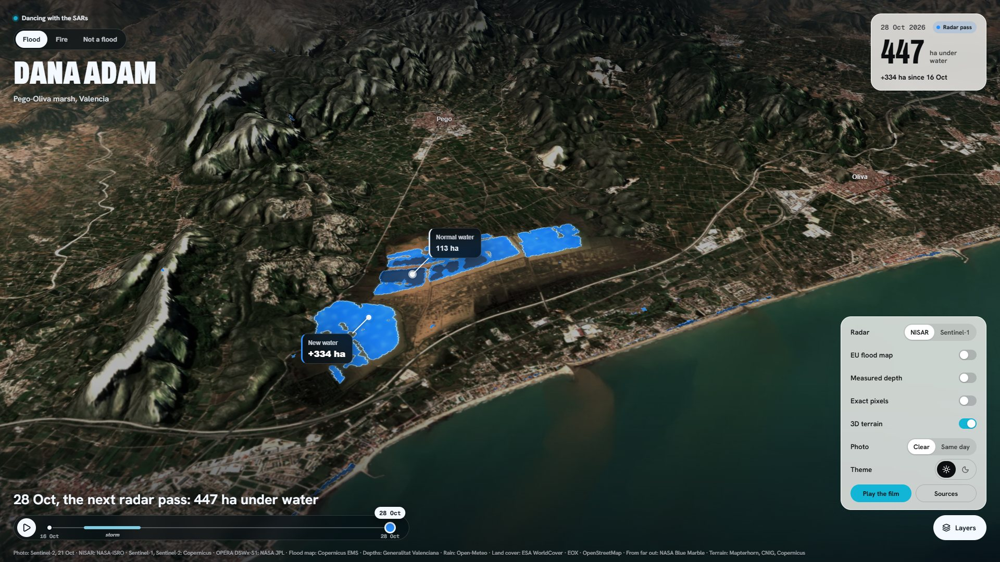</a> | **a1 The app by day**, with the Layers panel open. |
| <a href="storyboard/a2_sentinel1.jpg">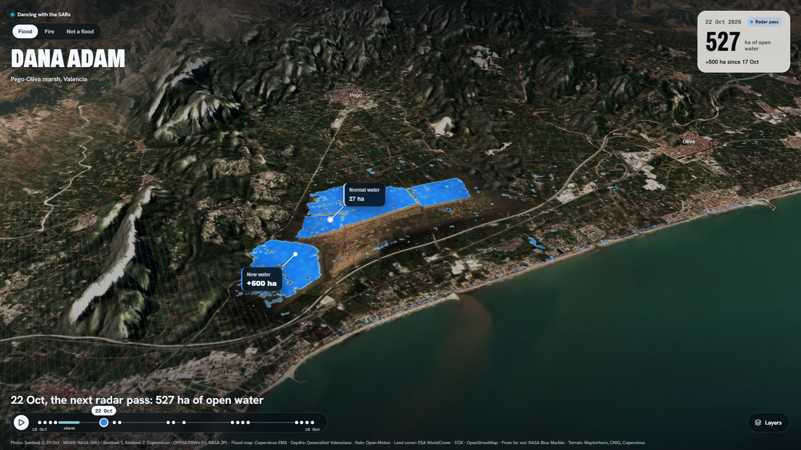</a> | **a2 Sentinel-1**, the second radar of the flood page. |
| <a href="storyboard/a3_exact_pixels.jpg"></a> | **a3 Exact pixels**: the radar pixels as delivered. |
| <a href="storyboard/a4_phone.jpg">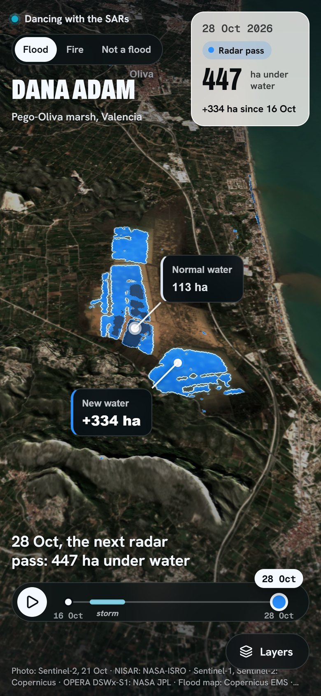</a> | **a4 A phone.** |
| <a href="storyboard/m1_sink_mock.jpg">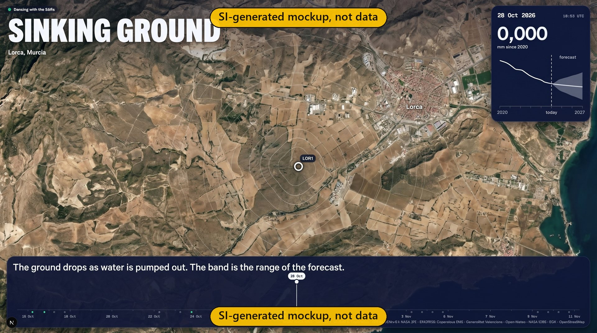</a> | **m1 Mockup: sinking ground, Lorca.** A ring at the station, a falling line on a chart, the forecast as a band that widens. Not built. |
| <a href="storyboard/m2_forecast_mock.jpg">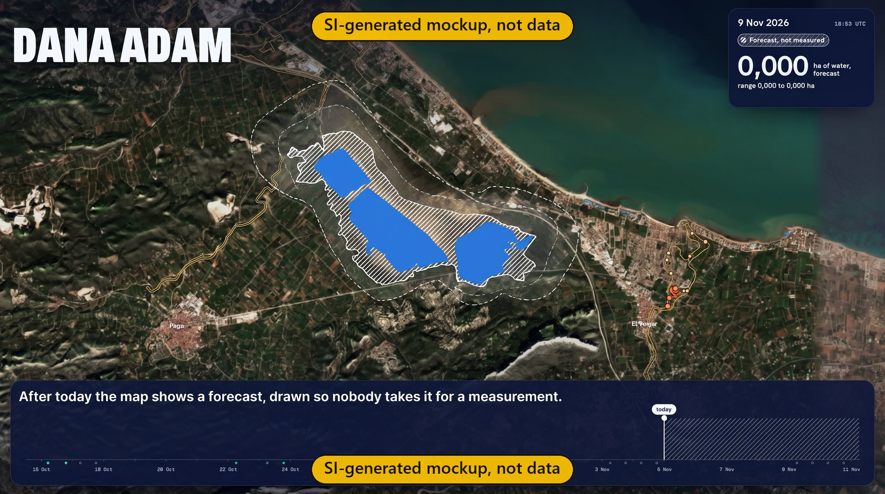</a> | **m2 Mockup: the forecast.** Stripes and a range after today, never a solid fill. Not built; the shader mode exists and needs data. |

## 13. What each model should deliver for the map

| Model | Layer | Format |
|---|---|---|
| CV, water | Per pass, as now | `data/cv/<site>_<stack>/<date>_water.tif`, EPSG:3857, uint8: 0 not water, 1 water, 2 flooded vegetation, 255 no data or sea, plus the manifest entry |
| CV, probability | Per pass (delivered, not read by the bake yet) | `<date>_water_p.tif`, manifest layer `water_probability`. Lets the map draw the uncertain band at a pass. |
| CV, burn | Per pass, Espadà (delivered) | `<date>_burn.tif`, uint8: 0, 1 burned, 255, manifest layer `burn` |
| Prediction, flood | Per forecast day | A probability raster on the site grid plus median and range in hectares. The map draws stripes above 50 % and the range as outlines. |
| Prediction, Lorca | As now | `forecast.json` and `observations.csv` |
| ML, classes | As now | A class COG; the map can tint the water by class |

The bake picks up every CV layer listed in `data/manifest.json` by itself. The exported layers are EPSG:3857 with 19.109 m pixels: count hectares with the cosine of the latitude squared, or they come out 1.7 times too large [data].

## 14. Not verified, limits, open

3D and the screen:

- `renderToTerrainTile` is marked experimental in MapLibre 6.18. An update of the library may change it.
- Sharpness of the draped layer on a 2x screen was not measured.
- The terrain endpoint has no stated terms that we found. A spare source, the Terrain Tiles on AWS, is in `scene3d.ts`, not switched on.
- With terrain off the layers stay hidden until the globe has turned flat: by code, not checked in a screenshot. MapLibre warns that fog is not supported on the globe; nothing looked wrong.
- The frame rate was measured in a headless browser on one desktop graphics card. The cost of the moving light on a battery was not measured.
- Phones: the layout was looked at in a 390 x 844 emulation; the 3D layers only ran on a desktop graphics card. Short screens, a phone on its side for one, are not laid out.
- Lorca and the forecast are not built. The probability layers of the CV session are not read yet.
- `bake_context.py --fire` still writes `espada/outline.json`. Nothing reads it now.
- Only two references were opened (Zoom Earth and NASA Worldview). A wider reference page was not built.

Data:

- The gauge total of 634 mm at Pego (AEMET) and FIRMS hot spots for the fire [not checked].
- The EFFIS record was last updated on 26 Jul 2026, one day into the fire. A later and larger outline may exist [not checked]. The end date of the fire is not in the files used here, so the page only names its start.
- The burn against the EFFIS outline: 4,932 ha inside, precision 0.93 (the CV session, on its own grid). On the grid of the map: 4,937 ha of 5,340 ha, 92 % [data].

Open for Ilija: day or night as the default (both work; the film frames are by night), and whether the rice season stays as the third tab.

## 15. Run it and rebuild it

```bash
cd web
pnpm install
pnpm dev
```

Then open `http://localhost:3000/flood`, `/fire` or `/rice`. Add `?story` for the film, `?still` for a page that does not move by itself.

Rebuild the layers (Python with rasterio, scipy, geopandas, earthaccess; the pipeline environment has them):

```bash
python scripts/bake_water.py --site pego_oliva --start 2026-10-16 --end 2026-11-10 --stacks 066_D_069 --data-root ../data
python scripts/fetch_optical.py --site pego_oliva --days 2026-10-08 2026-10-18 2026-10-21 2026-10-28
python scripts/bake_context.py --data-root ../data
python scripts/bake_water.py --site albufera --start 2026-06-18 --end 2026-10-28 --no-s1 --stacks 066_D_069 --data-root ../data
python scripts/fetch_optical.py --site albufera --days 2026-06-30 2026-07-28 2026-08-29 2026-09-08 2026-10-08 2026-10-21
python scripts/bake_water.py --site espada --layer burn --no-s1 --start 2026-06-18 --end 2026-10-28 --data-root ../data
python scripts/fetch_optical.py --site espada --days 2026-07-23 2026-07-28 2026-08-19 2026-09-11 2026-10-21
python scripts/bake_story.py --data-root ../data
```

`bake_context.py` writes `rain.json`, which the flood page reads, and `outlines.json`, from which `bake_story.py` takes the area of the Copernicus product. Run `bake_story.py` last: it measures the frames the others wrote.

Frames and films:

```bash
python scripts/shoot_flood.py out --story flood --cinema --theme dark --size 1920x1080 --base http://localhost:3000
python scripts/shoot_flood.py out --story fire --shots before burning estimate first october official --cinema --base http://localhost:3000
python scripts/record_flood.py out --url "http://localhost:3000/flood?story" --seconds 70 --screencast
python scripts/make_storyboard.py --real 04_after=out/after.png --mock m1_sink=mock/lorca.png
```

- `shoot_flood.py`: `--story` picks the page, `--shots` the moments (all when left out), `--cinema` the film look, `--theme` day or night, `--base` the server.
- `record_flood.py` waits until the way in has loaded, then records until the story ends or `--seconds` have passed. With `--screencast` it takes the frames from the Chrome or Edge of the computer and makes the film with the `ffmpeg` on the path; on a busy computer take it a few times and keep the smoothest.
- Both scripts fall back to the Chrome or Edge of the computer when Playwright has no browser of its own, so nothing has to be downloaded.
- `make_storyboard.py` writes the frames at 1,920 px and stamps every mockup with a visible mark.

The landing page plays the films on its monitor (`web/src/components/monitor.tsx`): the story on screen plays, the scroll picks the story, and a button opens its page.

```bash
python scripts/landing_films.py                                  # encode the recordings in web/.cache/film
python scripts/landing_films.py --record http://localhost:3000   # record the three stories first
```

- It writes `web/public/films/<page>.mp4` (1,280 x 720, 4 to 5 MB each), the first frame as `<page>.jpg` and a late frame as `<page>-still.jpg` for people who ask for less motion.
- Run it again after the layers are baked again: a film shows the numbers of the day it was recorded.
- The old 2D explorer at `/map` is retired. `/map?story=fire` opens `/fire`; `/map` and every other old address open `/flood` (redirects in `web/next.config.ts`). The old value stays in the address, so `?story` plays the film only when it has no value.

<sub>Drafted with an SI assistant (Claude Code). Frames marked mockup are SI-generated and watermarked. Decisions on the idea and the look stay with the team.</sub>
