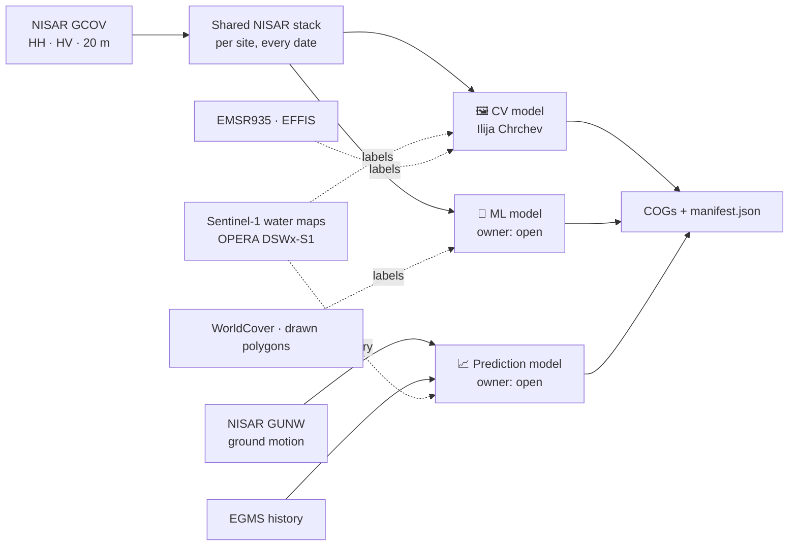

# Models

**Three models, three owners. Each one answers a different question with NISAR data.**

| | Model | Owner | Question it answers | Delivers |
|:---:|---|---|---|---|
| 🖼️ | [**CV**: surface masks](#cv-model) | **Ilija Chrchev** (`@ilijachrchev`) | Where is the water, flooded vegetation or burned ground in this scene? | Mask maps per date + accuracy scores |
| 🧮 | [**ML**: change classes](#ml-model) | ⬜ *Open: add your name* | What kind of land is this pixel, and how does it change through the season? | Class map + confusion matrix |
| 📈 | [**Prediction**: forecasts](#prediction-model) | ⬜ *Open: add your name* | What happens next, and how sure are we? | Forecasts with ranges + backtest scores |

## How they fit together

CV and ML read the same NISAR stack but answer different questions. Prediction uses its own data, so none of the three waits on another.

---

## CV model

**Owner:** Ilija Chrchev (`@ilijachrchev`)

> 🖼️ Finds water, flooded vegetation and burned ground in each NISAR scene.

| | |
|---|---|
| **Sites** | Albufera (rice-field flooding) · Pego-Oliva marsh (DANA "Adam" flood) · Serra d'Espadà (wildfire) |
| **Data** | NISAR GCOV, HH and HV at 20 m. Tracks 058 A, 066 D and 167 D, 18 Jun to 28 Oct 2026. Before/after pairs: Pego-Oliva on 066 D (16 → 28 Oct), Espadà on 058 A (24 Jul → 17 Aug and 16 Oct) |
| **Labels** | Same-day OPERA DSWx-S1 water maps (one for every Albufera date) · EMSR935 flood outline and the Generalitat 1,023 ha flood footprint · EFFIS burnt area (EMSR905) |
| **Processing** | Cut out the site · convert to dB (10·log10) · drop invalid pixels (mask layer) · 5×5 speckle filter · one grid per site (Valencia sits on UTM zones 30 and 31) · resample labels to 20 m · 256 px tiles |
| **Model** | Baseline: Otsu threshold per scene on HH; flooded vegetation where HH rises about 3 dB while HV stays flat. Then a small U-Net (segmentation-models-pytorch) with a TorchGeo Sentinel-1 encoder (HH → VV, HV → VH). Augmentation: flips and rotations only |
| **Check** | IoU and F1 against held-out DSWx-S1 dates, EMSR935 and EFFIS. Plus an L-band vs C-band disagreement map: where NISAR sees water under vegetation that Sentinel-1 misses |
| **Delivers** | 8-bit COG masks per date and layer (water, flooded vegetation, burn) + `metrics.json` |
| **Done when** | Every date at the three sites is masked, scored and listed in the manifest |
