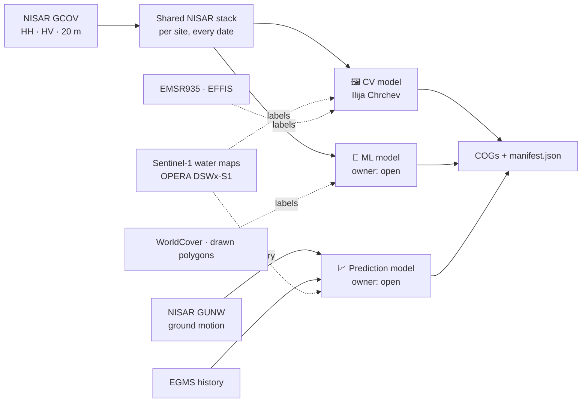

# Models

**Three models, three owners. Each one answers a different question with NISAR data.**

| | Model | Owner | Question it answers | Delivers |
|:---:|---|---|---|---|
| 🖼️ | [**CV**: surface masks](#cv-model) | **Ilija Chrchev** (`@ilijachrchev`) | Where is the water, flooded vegetation or burned ground in this scene? | Mask maps per date + accuracy scores |
| 🧮 | [**ML**: change classes](#ml-model) | ⬜ *Open: add your name* | What kind of land is this pixel, and how does it change through the season? | Class map + confusion matrix |
| 📈 | [**Prediction**: forecasts](#prediction-model) | ⬜ *Open: add your name* | What happens next, and how sure are we? | Forecasts with ranges + backtest scores |

## How they fit together

CV and ML read the same NISAR stack but answer different questions. Prediction uses its own data, so none of the three waits on another.
