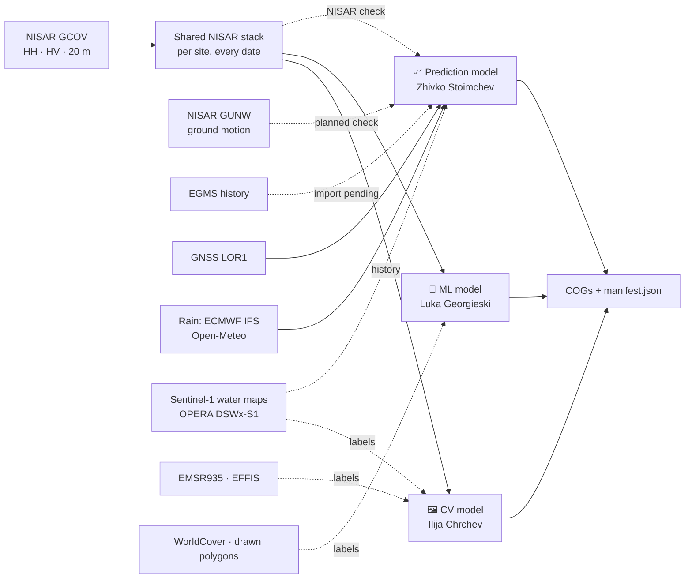

<div align="center">

# Models

**Three models, three owners. Each one answers a different question with NISAR data.**

</div>

| | Model | Owner | Question it answers | Delivers |
|:---:|---|---|---|---|
| 🖼️ | [**CV**: surface masks](#cv-model) | **Ilija Chrchev** (`@ilijachrchev`) | Where is the water, flooded vegetation or burned ground in this scene? | Mask maps per date + accuracy scores |
| 🧮 | [**ML**: change classes](#ml-model) | **Luka Georgieski** | What kind of land is this pixel, and how does it change through the season? | Class map + confusion matrix |
| 📈 | [**Prediction**: forecasts](#prediction-model) | **Zhivko Stoimchev** (`@zstoimchev`) | What happens next, and how sure are we? | Forecasts with ranges + backtest scores |

## How they fit together



CV and ML read the same NISAR stack but answer different questions. Prediction uses its own data, so none of the three waits on another.

---

## CV model

**Owner:** Ilija Chrchev (`@ilijachrchev`)

> 🖼️ Finds water, flooded vegetation and burned ground in each NISAR scene.

| | |
|---|---|
| **Sites** | Albufera (rice-field flooding) · Pego-Oliva marsh (DANA "Adam" flood) · Serra d'Espadà (wildfire) |
| **Data** | NISAR GCOV, HH and HV at 20 m. Tracks 058 A, 066 D and 167 D, 18 Jun to 28 Oct 2026. Before/after pairs: Pego-Oliva on 066 D (16 → 28 Oct), Espadà on 058 A (24 Jul → 17 Aug and 16 Oct) |
| **Labels** | Same-day OPERA DSWx-S1 water maps (one for every Albufera date) · EMSR935 flood outline and the Generalitat 1,023 ha flood footprint · EFFIS burnt area (EMSR905) |
| **Processing** | Read the shared stack (EPSG:32630, 20 m) · 5×5 speckle filter in linear power, then dB · keep only pixels valid on every compared date · resample labels to the same 20 m grid · 256 px tiles |
| **Model** | Baseline: Otsu threshold per scene on HH; flooded vegetation where HH rises about 3 dB while HV stays flat. Then a small U-Net (segmentation-models-pytorch) with a TorchGeo Sentinel-1 encoder (HH → VV, HV → VH). Augmentation: flips and rotations only |
| **Classes** | Per scene: water · flooded vegetation · burned. Per before/after pair: stable water · water gain · water loss · other change · not observed. Labelled "candidate" until checked against the labels |
| **Check** | IoU and F1 against held-out DSWx-S1 dates, EMSR935 and EFFIS. Plus an L-band vs C-band disagreement map: where NISAR sees water under vegetation that Sentinel-1 misses |
| **Delivers** | 8-bit COG masks per date and per pair + `metrics.json` + hectares per class (pixels × 0.04 ha on the 20 m grid), with a range from re-running at nearby thresholds |
| **Done when** | Every date at the three sites is masked, scored and listed in the manifest |

---

## ML model

**Owner:** Luka Georgieski · code in [`pipeline/ml/`](../pipeline/ml/)

> 🧮 Labels every pixel by how it behaves through the season: what kind of land it is and what changed.

| | |
|---|---|
| **Sites** | Albufera region (rice, wetland, orchards, urban) · Serra d'Espadà (forest and burn) |
| **Data** | The shared NISAR GCOV stack (`data/stack/<site>_<stack>.nc`): every date, HH and HV, 5×5 speckle filter in linear power, then dB, on the EPSG:32630 grid |
| **Labels** | ESA WorldCover land cover (10 m) · JRC Global Surface Water v1.5 occurrence, 1984 to 2024 (separates permanent water from seasonal water) · CORINE Land Cover 2018: rice fields (213) and orchard vs forest for WorldCover tree cover · EFFIS burnt area · 50 rice fields drawn in QGIS (all inside CORINE rice) · the sea is left out |
| **Processing** | One row per pixel with 29 time-series features: mean, std, min and max of HH and HV · HH/HV ratio · variability · date and size of the biggest drop and rise · lasting change (late minus early season, biggest drop of the mean after a date vs before it) · share of dark (water) dates. Train and test on separate 1 km blocks, balanced so every class gets about a quarter of its pixels in test |
| **Model** | LightGBM. Feature importance shows which polarization and which part of the season matter most. "Burned" is only allowed where HV dropped by 1.0 dB or more and stayed down. A 3×3 majority filter and a 5-pixel minimum patch clean specks off the map |
| **Classes** | Rice paddy · permanent water · urban · forest · burned · other crops and shrub · orchard |
| **Check** | Confusion matrix and per-class F1 on held-out blocks |
| **Delivers** | Class map COG + confidence COG + `metrics.json` + feature importance |
| **Done when** | Both sites are classified, scored and listed in the manifest |

---

## Prediction model

**Owner:** Zhivko Stoimchev (`@zstoimchev`)

> 📈 Forecasts what comes next, always with a range and a score against a simple baseline. Code in [`pipeline/prediction/`](../pipeline/prediction/).

**Status (14 Nov 2026):** three forecasts built, scored and committed with a date (#8, #14, #15, #17), plus a NISAR check of their inputs.

| | Forecast | Data | Held-out result | NISAR check |
|---|---|---|---|---|
| **A** | [Lorca ground sinking](../pipeline/prediction/README.md) | GNSS LOR1 (NGL), daily since 2009 | Selection on 2023 picks persistence ("no further change"). On the 2025 test, linear trend beats persistence by 14 % at 24 days and 8 % at 36 days, trend + annual cycle by 8 % and 1 %. Reported, not switched to. Sinking slowed from about 95 to about 40 mm/yr after 2023 | Not done (GUNW, see below) |
| **B** | [Albufera rice-field flooded area](../pipeline/prediction/albufera/README.md) | DSWx-S1, 413 passes since Aug 2024; CORINE rice mask, 14,791 ha | Climatology beats persistence by +42 / +60 / +64 % at 16 / 28 / 40 days on the 2026 season; 80 % ranges hold 73–80 % | ✅ NISAR and DSWx-S1 rise together in the autumn flooding |
| **C** | [Rain-threshold flood alert](../pipeline/prediction/flood/README.md) | IFS 9 km rain (Open-Meteo) + DSWx-S1, Albufera and Pego-Oliva | Held-out DANA: 2 of 2 caught, 0 false alarms in the surrounding weeks (too few events for a skill claim). Replay: amber 2–3 days ahead, never red | ✅ NISAR new water lies 87 % inside the official DANA outline |

**NISAR check** ([`nisar_check.py`](../pipeline/prediction/nisar_check.py), stacks `albufera_066_D_069` and `pego_oliva_066_D_069`, CV baseline from `pipeline.cv`):

- **Albufera rice, 11 NISAR dates, 5 with a Sentinel-1 pass within 2 h** (the 18 UTC pass; same pairing rule as `pipeline.cv.evaluate`): share of the rice mask darker than −15 dB on NISAR vs the share DSWx-S1 maps as flooded. **Autumn:** 6 → 14 → 31 % (NISAR) vs 2.5 → 10 → 22 % (DSWx-S1) on 4, 16 and 28 Oct. **Summer:** NISAR sees 44 % dark on 18 Jun, falling to 0 by late July, while DSWx-S1 sees about 2 %. That fits paddies flooded from May sowing until the August drainage, i.e. water among young rice that the C-band map misses, but it is not confirmed on the ground. Non-rice cropland stays at 0–1 % throughout. Correlation over the 5 paired dates: r = 0.34 (−15 dB, pulled down by 18 Jun), 0.65 (−18 dB); the per-scene Otsu threshold gives 0.14, because it follows the whole scene. Five points, so read the series, not r.
- **Pego-Oliva DANA, 16 → 28 Oct:** 212 ha of new NISAR water inside the EMSR935 mapped areas, **87 %** of it inside the official flood outline (62–93 % over ±1 dB); same region as `pipeline.cv.evaluate`, so it matches `cv_baseline.json`. DSWx-S1 inside the outline, on the 18 UTC passes: 234 → 408 ha.

**Done when:** every forecast has ranges, backtest scores and a committed, timestamped forecast file. ✅ Met for A, B and C.

**Still open:**
- **Lorca with EGMS** (2020–2025, gap-free; needs an EU Login download, see the prediction README). This is the fair test of trend vs persistence.
- **Lorca vs NISAR GUNW** (track 167 D): about half a day and risky (HDF5 metadata, ionosphere, line of sight vs vertical). Planned, not started.
- **Verifying the committed Albufera forecast** once the 26 Nov, 8 Dec and 20 Dec passes are published.

---

## Shared between the models

Agree on these two before anyone builds, so nobody waits on anybody.

**1. One NISAR stack** (read by CV and ML). Built once per site and track (tracks have different geometry, so they are never mixed):

- `pipeline.nisar_fetch`: **Harmony** cuts the site out of each NISAR file and returns COGs of `HHHH`, `HVHV`, `mask` and `numberOfLooks` in the file's native grid. No HDF5 parsing on our side.
- `pipeline.stack`: reprojects every date **once** onto the site grid, **EPSG:32630** (UTM 30N) with 20 m pixels snapped to the 20 m lattice. Power is resampled bilinearly in linear units, the mask by nearest neighbour. Resampling only once keeps the data closest to what NISAR delivered.
- Power stays linear in the stack; convert to dB where you need it (10·log10, not 20).
- A pixel is valid only if the GCOV `mask` is 1 to 5 (fully focused; 0 means partially focused, 255 is outside the radar footprint, per the GCOV spec JPL D-102274 Rev F), HH is finite and positive, and every source pixel under the bilinear kernel was valid. The `mask` is not a water mask.
- Reading the HDF5 files directly instead? GDAL older than 3.13 needs the NETCDF driver to place them on the map (rasterio here ships GDAL 3.12).

```
data/stack/<site>_<track>.nc    dims: time × y × x    vars: HH, HV (linear power), valid, looks    per date: granule_ur, crid, maturity, pols
```

Exact grids per site, where to download the stacks, and the labels already on those grids: [DATA.md](DATA.md).

**2. One output format** (written by all three). Analysis runs on EPSG:32630; display layers are 8-bit Cloud-Optimized GeoTIFFs, web-optimized (`rio cogeo create --web-optimized`), plus one entry per layer in `data/manifest.json` that says exactly which NISAR file it came from. Example entry (values are placeholders):

```json
{
  "model": "cv",
  "site": "albufera",
  "layer": "water",
  "date": "2026-10-28",
  "file": "data/cv/albufera/water_20261028.tif",
  "source": { "granule": "NISAR_L2_PR_GCOV_...", "crid": "P05036", "track": "066", "direction": "D", "frame": "069" },
  "valid_fraction": 0.0,
  "score": { "iou": 0.0 }
}
```

<sub>Data facts and sources: [RESEARCH.md](RESEARCH.md). Drafted with an SI assistant; the split and the owners are the team's choice.</sub>
