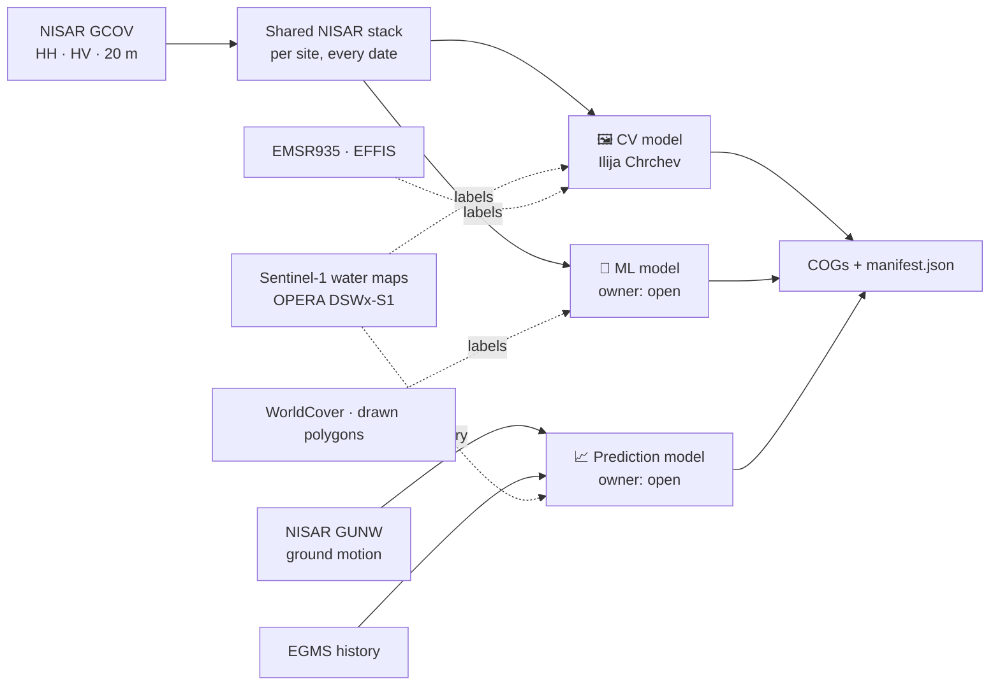

<div align="center">

# Models

**Three models, three owners. Each one answers a different question with NISAR data.**

</div>

| | Model | Owner | Question it answers | Delivers |
|:---:|---|---|---|---|
| 🖼️ | [**CV**: surface masks](#cv-model) | **Ilija Chrchev** (`@ilijachrchev`) | Where is the water, flooded vegetation or burned ground in this scene? | Mask maps per date + accuracy scores |
| 🧮 | [**ML**: change classes](#ml-model) | ⬜ *Open: add your name* | What kind of land is this pixel, and how does it change through the season? | Class map + confusion matrix |
| 📈 | [**Prediction**: forecasts](#prediction-model) | ⬜ *Open: add your name* | What happens next, and how sure are we? | Forecasts with ranges + backtest scores |

## How they fit together



CV and ML read the same NISAR stack but answer different questions. Prediction uses its own data, so none of the three waits on another.

---

## CV model

**Owner:** Ilija Chrchev (`@ilijachrchev`)

> 🖼️ Finds water, flooded vegetation and burned ground in each NISAR scene.

| | |
|---|---|
| **Sites** | Albufera (rice-field flooding) · Pego-Oliva marsh (DANA "Adam" flood) · Serra d'Espadà (wildfire) |
| **Data** | NISAR GCOV, HH and HV at 20 m. Tracks 058 A, 066 D and 167 D, 18 Jun to 28 Oct 2026. Before/after pairs: Pego-Oliva on 066 D (16 → 28 Oct), Espadà on 058 A (24 Jul → 17 Aug and 16 Oct) |
| **Labels** | Same-day OPERA DSWx-S1 water maps (one for every Albufera date) · EMSR935 flood outline and the Generalitat 1,023 ha flood footprint · EFFIS burnt area (EMSR905) |
| **Processing** | Read the shared stack (EPSG:32630, 20 m) · 5×5 speckle filter in linear power, then dB · keep only pixels valid on every compared date · resample labels to the same 20 m grid · 256 px tiles |
| **Model** | Baseline: Otsu threshold per scene on HH; flooded vegetation where HH rises about 3 dB while HV stays flat. Then a small U-Net (segmentation-models-pytorch) with a TorchGeo Sentinel-1 encoder (HH → VV, HV → VH). Augmentation: flips and rotations only |
| **Classes** | Per scene: water · flooded vegetation · burned. Per before/after pair: stable water · water gain · water loss · other change · not observed. Labelled "candidate" until checked against the labels |
| **Check** | IoU and F1 against held-out DSWx-S1 dates, EMSR935 and EFFIS. Plus an L-band vs C-band disagreement map: where NISAR sees water under vegetation that Sentinel-1 misses |
| **Delivers** | 8-bit COG masks per date and per pair + `metrics.json` + hectares per class (pixels × 0.04 ha on the 20 m grid), with a range from re-running at nearby thresholds |
| **Done when** | Every date at the three sites is masked, scored and listed in the manifest |

---

## ML model

**Owner:** `⬜ Open: add your name here`

> 🧮 Labels every pixel by how it behaves through the season: what kind of land it is and what changed.

| | |
|---|---|
| **Sites** | Albufera region (rice, wetland, orchards, urban) · Serra d'Espadà (forest and burn) |
| **Data** | The shared NISAR GCOV stack: every date, HH and HV in dB, on the EPSG:32630 grid |
| **Labels** | ESA WorldCover land cover (10 m) · JRC Global Surface Water v1.5 occurrence, 1984 to 2024 (separates permanent water from seasonal water) · EFFIS burnt area · polygons drawn in QGIS for rice paddies and open water |
| **Processing** | One row per pixel with time-series features: mean, std, min and max of HH and HV · HH/HV ratio · variability · date and size of the biggest drop and rise · number of dark (water) dates. Train and test on separate map blocks so neighbouring pixels do not leak |
| **Model** | LightGBM or XGBoost. Feature importance shows which polarization and which part of the season matter most |
| **Classes** | Rice paddy · permanent water · urban · forest · burned · other crops and shrub |
| **Check** | Confusion matrix and per-class F1 on held-out blocks |
| **Delivers** | Class map COG + confidence COG + `metrics.json` + feature importance |
| **Done when** | Both sites are classified, scored and listed in the manifest |

---

## Prediction model

**Owner:** `⬜ Open: add your name here`

> 📈 Forecasts what comes next, always with a range and a score against a simple baseline.

**A. Ground sinking in Lorca (Alto Guadalentín)**

| | |
|---|---|
| **Data** | EGMS Ortho vertical motion, 100 m grid, 2020 to 2025 (free EU Login) · GNSS station LOR1 (Nevada Geodetic Laboratory) · NISAR GUNW track 167 D, 25 Jun to 11 Oct 2026, 7 pairs |
| **Processing** | Clip EGMS to Lorca, one time series per point · NISAR phase to motion: d = -λ/(4π) · φ, with λ about 24.4 cm · subtract a stable reference pixel · remove the ionosphere screen shipped in each file · chain the 12, 24 and 36-day pairs into one series |
| **Model** | Linear trend + yearly sine per point, with conformal ranges (MAPIE) |
| **Check** | Backtest: train 2020 to 2023, test 2024 to 2025, against constant and straight-line baselines. Then the real test: the EGMS forecast for Jun to Oct 2026 against what NISAR measured, an independent sensor |
| **Delivers** | Forecast JSON per point (median, 80% and 95% ranges) · backtest scores · forecast vs NISAR comparison |

**B. Flooded area in the Albufera**

| | |
|---|---|
| **Data** | OPERA DSWx-S1 water history since Aug 2024 (two seasons) · NISAR dates for the current state. Uses the Sentinel-1 maps, not the CV masks, so it never waits on CV |
| **Processing** | Flooded hectares per date inside the rice area |
| **Model** | Day-of-year baseline + the current anomaly |
| **Check** | Leave one season out · skill against persistence. Forecasts for the next passes are committed to git before that data is published |
| **Delivers** | Forecast JSON (median and range per upcoming pass) + skill score |

**Done when:** both forecasts have ranges, backtest scores and a committed, timestamped forecast file.

---

## Shared between the models

Agree on these two before anyone builds, so nobody waits on anybody.

**1. One NISAR stack** (read by CV and ML). Built once per site and track (tracks have different geometry, so they are never mixed):

- `pipeline.nisar_fetch`: **Harmony** cuts the site out of each NISAR file and returns COGs of `HHHH`, `HVHV`, `mask` and `numberOfLooks` in the file's native grid. No HDF5 parsing on our side.
- `pipeline.stack`: reprojects every date **once** onto the site grid, **EPSG:32630** (UTM 30N) with 20 m pixels snapped to the 20 m lattice. Power is resampled bilinearly in linear units, the mask by nearest neighbour. Resampling only once keeps the data closest to what NISAR delivered.
- Power stays linear in the stack; convert to dB where you need it (10·log10, not 20).
- A pixel is valid only if the GCOV `mask` is 1 to 5 (fully focused; 0 means partially focused, 255 is outside the radar footprint, per the GCOV spec JPL D-102274 Rev F), HH is finite and positive, and every source pixel under the bilinear kernel was valid. The `mask` is not a water mask.
- Reading the HDF5 files directly instead? GDAL older than 3.13 needs the NETCDF driver to place them on the map (rasterio here ships GDAL 3.12).

```
data/stack/<site>_<track>.nc    dims: time × y × x    vars: HH, HV (linear power), valid, looks    per date: granule_ur, crid, maturity, pols
```

Exact grids per site, where to download the stacks, and the labels already on those grids: [DATA.md](DATA.md).

**2. One output format** (written by all three). Analysis runs on EPSG:32630; display layers are 8-bit Cloud-Optimized GeoTIFFs, web-optimized (`rio cogeo create --web-optimized`), plus one entry per layer in `data/manifest.json` that says exactly which NISAR file it came from. Example entry (values are placeholders):

```json
{
  "model": "cv",
  "site": "albufera",
  "layer": "water",
  "date": "2026-10-28",
  "file": "data/cv/albufera/water_20261028.tif",
  "source": { "granule": "NISAR_L2_PR_GCOV_...", "crid": "P05036", "track": "066", "direction": "D", "frame": "069" },
  "valid_fraction": 0.0,
  "score": { "iou": 0.0 }
}
```

<sub>Data facts and sources: [RESEARCH.md](RESEARCH.md). Drafted with an SI assistant; the split and the owners are the team's choice.</sub>
