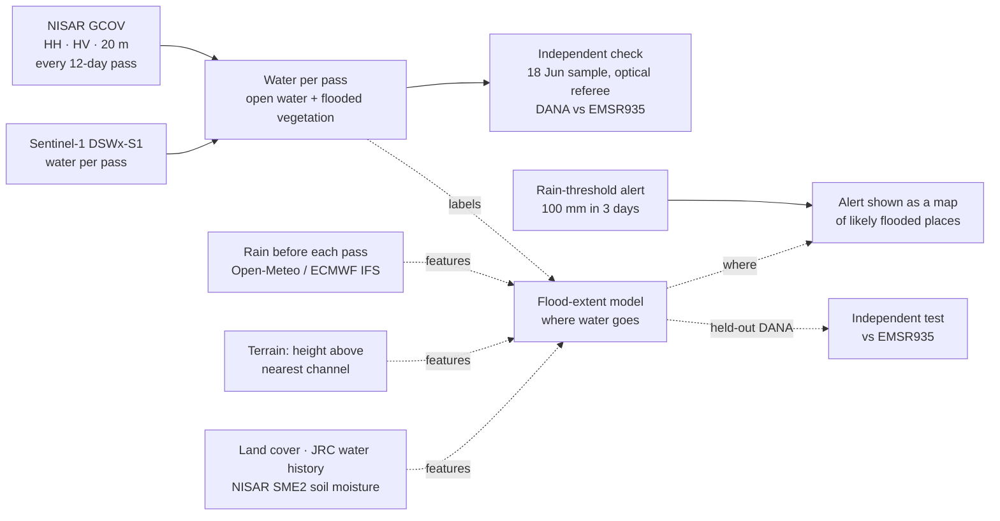

# Where will the water go? Learning flood extent in Valencia from the first months of NISAR L-band data

**Luka Georgieski, Ilija Chrchev, Zhivko Stoimchev**
NASA Space Apps Challenge 2026, Valencia · challenge "Dancing with the SARs"

*Draft of 14 November 2026. Sections marked **[PLACEHOLDER]** wait for the flood-extent model, which is still being built; they will be filled from its result files when it lands on GitHub. Every number in this paper is read from a result file in the repository; `docs/paper/numbers.md` lists each value with its source, and the HTML comments `<!--#key-->` in the Markdown source point to that list.*

---

## Abstract

A rain alert tells people how much rain will fall; it does not tell them which fields, roads and neighbourhoods will be under water. We ask whether the first months of NASA-ISRO NISAR L-band radar data can help close that gap for the Valencia region. NISAR cannot forecast rain or floods, but it records where water actually is on every 12-day pass, through clouds and, at L-band, partly beneath crops. Our approach is to use those per-pass water maps as training labels for a model that learns *where* water collects given rain, terrain and land cover, so that an existing rain alert can be shown as a map of likely flooded places. Before training on NISAR water, we tested whether it is trustworthy. On 18 June 2026, inside 14,627.8 ha<!--#june.rice_ha--> of Albufera rice, NISAR mapped 6,387.2 ha<!--#june.nisar_ha--> of water and the Sentinel-1 water product DSWx-S1 249.6 ha<!--#june.s1_ha-->. A stratified sample of 513<!--#june.n_points--> points, fixed in git before scoring and judged by an optical-only referee, gives NISAR a producer's accuracy of 0.52<!--#v2.nisar.producer--> against 0.02<!--#v2.s1.producer--> for DSWx-S1 and 0.04<!--#v2.unet.producer--> for a C-band-trained U-Net; where only NISAR sees water, the referee agrees in 0.94<!--#v2.b_wet_share--> of decided points (95 % interval 0.86–1.00<!--#v2.ci95.b_user-->), which passes a rule fixed in advance. A strict open-water referee does not confirm this (3 of 29 decided points wet), so the extra NISAR water is wet ground or water under young plants rather than open water. During DANA "Adam" (17–19 October 2026) at Pego-Oliva, 87 %<!--#pego.inside_share--> of 212 ha<!--#pego.new_ha--> of new NISAR water lies inside the official Copernicus EMSR935 flood outline, but NISAR's two passes (16 and 28 October) missed the peak that Sentinel-1 sampled 18<!--#pego.s1_passes--> times. The flood-extent model and its independent test against EMSR935 are **[PLACEHOLDER]**. With only five months of data and one large test event, this is a demonstration of what is possible, not proof; we expect it to improve as NISAR keeps collecting.

---

## 1. Introduction

**Opening: an alert without a map.** Two of the authors were Erasmus students in Valencia in autumn 2026 when the weather service issued yellow, orange and red rain warnings, and they could not tell what any of them meant for their own street. The region has reason to take such warnings seriously: the DANA of 29 October 2024 caused catastrophic flash floods in the province of Valencia [citation needed: official report]. A rain warning answers "how much rain, where, when". It does not answer the question a resident actually has: "will *my* road, field or neighbourhood flood?" The gap between a rain total and a flooded place is the subject of this paper.

**The forecast is not the problem; the footprint is.** Numerical weather prediction already sees large storms coming. In our replay of the October 2026 DANA, the ECMWF IFS 9 km run of 15 October already put 68.9 / 55.7 mm<!--#alert.run15_daily_18_19--> of rain on 18 and 19 October at the wettest grid point over Pego-Oliva, three to four days ahead (Section 5.5). Satellites cannot add to that: no radar predicts rain. What is missing is a link from rain to flooded ground, which depends on terrain, drainage, land cover and how wet the soil already is. Hydraulic models provide that link where they have been built and calibrated, but they need river geometry, defences and inflow data that many small Mediterranean catchments do not have.

**Learning the footprint from observed water needs many honest water maps.** A data-driven alternative is to learn, from many past events, where water appears after a given rain. The bottleneck is labels: one needs a reliable water map for every pass, including under vegetation and through clouds. Optical images are blocked by the clouds that come with storms. C-band radar (Sentinel-1) sees through clouds but loses water beneath crops and marsh vegetation, and the operational DSWx-S1 product maps inundated vegetation only where its land-cover layer says "wetland" [OPERA DSWx-S1]. L-band radar penetrates further into vegetation [Hess et al. 1990], and NISAR is the first mission to provide free, systematic L-band coverage on an exact 12-day repeat [NISAR Handbook; ASF NISAR docs]. However, NISAR's calibrated public data only begin with acquisitions of 17 June 2026, and no independent check of its water maps over Spain existed.

**Our approach.** We use NISAR not as a predictor but as a teacher. Our innovation is to treat each NISAR pass as a labelled example of where water went, and to learn the mapping from rain before the pass, terrain (height above the nearest channel), land cover, long-term water history and NISAR soil moisture to the observed water. The trained model turns an existing rain alert into a map of likely flooded places. Because the labels drive everything, we first test them: an independent, pre-registered, sample-based accuracy assessment of NISAR water against Sentinel-1 on a date where the two disagree most.

**Contributions.**
1. **An independent, pre-registered check of early NISAR water maps.** On 18 June 2026 in the Albufera rice, NISAR finds about half of the water an optical referee calls wet (producer's accuracy 0.52<!--#v2.nisar.producer-->), where DSWx-S1 finds 0.02<!--#v2.s1.producer-->. Sample points and the pass rule were committed to git before scoring. We also report the result that goes against us: a strict open-water referee does not confirm the extra NISAR water.
2. **An event check against an official flood outline.** For DANA "Adam", 87 %<!--#pego.inside_share--> of new NISAR water lies inside the Copernicus EMSR935 outline; we also show why NISAR's sparse sampling missed the peak.
3. **A flood-extent model trained on NISAR water labels** and its independent test on the held-out DANA. **[PLACEHOLDER: method and results]**
4. **Open code and data** with every number traceable to a result file, plus a plain statement of what five months of data can and cannot show.

---

## 2. Background and related work

**SAR water mapping and the vegetation problem.** Calm open water reflects radar away from the sensor and appears dark, so water is commonly mapped by thresholding backscatter, often with a per-scene threshold such as Otsu's method [Otsu 1979]. Vegetation standing in water behaves differently: the wave bounces off the water surface and then off stems back to the sensor ("double bounce"), so flooded vegetation can appear *brighter* than dry vegetation in co-polarised HH, while cross-polarised HV changes little [Hess et al. 1990]. Longer wavelengths reach the water beneath a canopy more often, which is why L-band is preferred for flooded forest and marsh. C-band missions such as Sentinel-1 provide frequent, free data but see water under young crops less reliably. Built-up areas are hard for every SAR: walls and ground form double-bounce corners, and layover and shadow hide streets, so urban flood mapping from SAR remains an open problem [Mason et al. 2010].

**Operational water and flood products.** NASA's OPERA project publishes DSWx-S1, a 30 m Sentinel-1 water map with classes for open water and inundated vegetation; by design the inundated-vegetation class is only issued where the ancillary land cover is wetland [OPERA DSWx-S1]. Copernicus Emergency Management Service (EMS) rapid mapping delivers analyst-checked flood outlines for major events, such as EMSR935 for DANA "Adam" [Copernicus EMS EMSR935]. These products are excellent references for single events but do not, on their own, predict where a future storm's water will go.

**Where water goes: terrain and learned susceptibility.** Terrain descriptors such as Height Above the Nearest Drainage (HAND) explain much of where floods can occur [Rennó et al. 2008; Nobre et al. 2011], and long records of surface water such as the JRC Global Surface Water dataset show where water has been before [Pekel et al. 2016]. Machine-learning flood-susceptibility maps combine such static factors, but they are usually trained on a handful of mapped events and do not condition on the rain of a specific storm. Our setting differs in that the labels are a regular time series of observed water, one per radar pass, which lets a model learn how the footprint changes with the rain before each pass.

**Honest accuracy assessment.** Accuracy and area estimates from maps are biased when checked on convenience samples or against another map. Olofsson et al. [2014] set out good practice: a probability sample stratified by map class, stratum-weighted estimators of user's and producer's accuracy, and confidence intervals. For classifiers on rasters, spatially blocked validation avoids optimistic scores from neighbouring pixels [Roberts et al. 2017]. We follow both.

---

## 3. Study area and data

### 3.1 Sites

We work at three sites around Valencia (Spain):

- **Albufera de València**, a coastal lagoon surrounded by about 14,790.6 ha<!--#alb.rice_mask_ha--> of rice (CORINE 2018 class 213). The paddies are flooded on purpose from sowing in May to drainage in August and again in winter, so "water" here is often farm water, not a flood.
- **Pego-Oliva marsh**, south of Valencia, flooded by DANA "Adam" on 17–19 October 2026 and mapped by Copernicus EMS (EMSR935).
- **Serra d'Espadà** (Castellón), used only for the land-class model (a summer 2026 wildfire).

### 3.2 NISAR data and its maturity

NISAR, a joint NASA-ISRO L-band (wavelength about 24 cm) and S-band SAR, launched on 30 July 2025 [ASF NISAR docs]. Table 1 summarises the public data available to us. All NISAR data used here are PROVISIONAL or VALIDATED; BETA data were not used.

*Table 1. NISAR data maturity and products used (ASF NISAR documentation, accessed 14 Nov 2026).*

| Item | Value |
|---|---|
| Launch | 30 Jul 2025 |
| BETA (not calibrated; not used) | Released 23 Jan and 27 Feb 2026; subset of acquisitions 17 Oct 2025 – 20 Jan 2026 |
| PROVISIONAL | Released 20 Jul 2026; acquisitions from 17 Jun 2026 to 21–23 Oct 2026 (ASF and the CMR catalogue differ slightly on the end date) |
| VALIDATED (L0–L2) | Released 6 Nov 2026; acquisitions from 21 Oct 2026 on |
| Permanent data gap | 27 Jul – 10 Aug 2026 |
| GCOV (backscatter) | HH and HV, 20 m, map-projected, linear power |
| GUNW (interferograms) | Unwrapped phase and coherence at 80 m |
| SME2 (soil moisture) | 200 m, PROVISIONAL only, "not fully calibrated", withheld or flagged over dense vegetation |
| Repeat | 12 days per track |

At Albufera we use two GCOV tracks, 066 D (evening) and 058 A (morning), each reprojected once onto a common 20 m grid (EPSG:32630) after a 5 × 5 speckle filter in linear power. Pego-Oliva is observed by track 066 D on 16 and 28 October 2026, either side of the DANA. The 16 → 28 October pair mixes PROVISIONAL and VALIDATED processing, which ASF advises using with caution.

### 3.3 Reference and auxiliary data

- **DSWx-S1** (OPERA, 30 m), with a pass within about 1 h of NISAR at Albufera on 18 June (17:54 UTC vs 18:53 UTC<!--#june.nisar_utc-->).
- **Optical images** for the independent referee: Sentinel-2 L2A on 8 June and 23 June, Landsat 9 on 22 June 2026. The only image on 18 June itself was fully clouded over the rice.
- **Copernicus EMSR935** flood outline (imagery of 20 October) and the Generalitat Valenciana river-flood footprint for DANA "Adam".
- **Rain**: ECMWF IFS 9 km forecasts and archive via Open-Meteo.
- **Labels for the land-class model**: ESA WorldCover, JRC Global Surface Water occurrence, CORINE 2018, EFFIS burnt area and hand-drawn rice fields.

---

## 4. Method

### 4.1 Overview

Figure 1 shows the pipeline. NISAR provides one water map per pass (4.2). Before these maps are used as labels, an independent check measures how right they are (4.3). The flood-extent model learns where water appears given rain and terrain (4.4) and is tested on the held-out DANA against EMSR935 under a test fixed before the model exists (4.5). An existing rain alert (4.6) chooses *when* to show the map; the model chooses *where*.

*Figure 1. Pipeline. Solid arrows: built and tested. Dashed: in progress.*

### 4.2 Water from each NISAR pass

**Motivation.** The model needs one water map per pass that does not depend on the C-band products it is compared with. **Design.** Open water is a pixel whose 5 × 5-filtered HH is below −15.0 dB<!--#june.threshold_db-->. The threshold was fixed before any comparison (the fallback of our land-class pipeline), and was later confirmed on the second Albufera track, which played no part in choosing it: across 10<!--#alb.058.paired--> paired dates on track 058 A, NISAR's dark share of the rice and DSWx-S1's flooded share correlate at r = 0.978<!--#alb.058.r15-->. The labels for the flood-extent model add a flooded-vegetation class, where HH rises by about 3 dB between passes while HV stays flat (double bounce), and merge NISAR with Sentinel-1 water on each pass (work by I. Chrchev; **[PLACEHOLDER: final label rules and per-pass counts]**). **Advantage.** L-band reaches water beneath young crops more often than C-band; Section 5.1 tests whether this is true here.

### 4.3 Independent check of NISAR water on 18 June 2026

**Motivation.** On 18 June 2026 the two radars disagree most: inside the scored rice, NISAR (066 D) maps 6,387.2 ha<!--#june.nisar_ha--> of water and DSWx-S1 249.6 ha<!--#june.s1_ha-->. If NISAR is right, it sees water that C-band misses; if wrong, it would poison the labels. A third map, the web app's U-Net water layer, was trained on DSWx-S1 labels and is scored on the same points.

**Design: sample.** Following Olofsson et al. [2014], rice pixels are split into four strata by the two radar maps: A both say water, B NISAR only, C Sentinel-1 only, D neither; stratum E is non-rice cropland (WorldCover class 40), a control that should be dry. Candidates lie on a 200<!--#june.grid_m--> m grid with a random offset, so no two points are neighbours, and points are drawn at random per stratum with a fixed seed (Table 2). The 513<!--#june.n_points--> points were committed to git (commit `682d951`) before any scoring.

*Table 2. Strata, area and sample size.*

| Stratum | Meaning | Area (ha) | Points |
|---|---|---:|---:|
| A | both maps say water | 116.2<!--#june.ha_A--> | 25<!--#june.n_A--> |
| B | NISAR only | 6,271.0<!--#june.ha_B--> | 150<!--#june.n_B--> |
| C | Sentinel-1 only | 133.4<!--#june.ha_C--> | 38<!--#june.n_C--> |
| D | neither (rice) | 8,107.2<!--#june.ha_D--> | 150<!--#june.n_D--> |
| E | control, non-rice cropland | 5,661.2<!--#june.ha_E--> | 150<!--#june.n_E--> |

**Design: referee.** The referee never uses a radar, so the check is not circular. A point is wet on an optical date when the rice-flooding signal holds, LSWI + 0.05 ≥ EVI [Xiao et al. 2005], or MNDWI > 0 [Xu 2006]. Because 18 June itself is clouded, the label brackets the date: *wet* if wet on 8 June (Sentinel-2, 10 days before) **and** on the closest clear look after (Landsat 9, 22 June; Sentinel-2, 23 June where Landsat is cloudy), *dry* if dry on both, otherwise *unclear*. Unclear points are not imputed; instead we report bounds with every unclear point set dry and every one set wet. A strict variant uses MNDWI > 0 alone, the open-water signal, which wet mud trips less often.

**Design: scoring and pre-registered rule.** User's and producer's accuracy are stratum-weighted (weight = stratum share of the rice) over decided points, with 95 % intervals from a stratified bootstrap (2,000 resamples). The pass rule was posted on GitHub Discussion #25 before the first score: NISAR "wins" if its user's accuracy in stratum B is at least 0.7<!--#rule.min_share--> and the lower end of its 95 % interval is at least 0.6<!--#rule.min_ci_low-->. **Transparency note:** a first version of the referee (8 and 23 June) was run first (commit `54fdc99`); after a team review, the after-image was changed to the closest clear look (Landsat 9, 22 June) and committed as rule v2 (`e5a2d30`) before v2 was run (`de3e9f8`). The pass rule itself did not change. Both versions are reported.

### 4.4 Flood-extent model — **[PLACEHOLDER]**

> **To be filled from Z. Stoimchev's model once on GitHub** (expected under `pipeline/prediction/`). Planned design, as agreed in Discussion #29:
> - **Target:** per pixel and per pass, water (open water or flooded vegetation) from the labels of Section 4.2.
> - **Features:** rain before each pass (Open-Meteo, ECMWF IFS), height above the nearest channel, land cover, JRC water occurrence, NISAR SME2 soil moisture before the pass.
> - **Training data:** all passes from 17 June to the cut-off, **excluding** the DANA window, which is held out for Section 4.5.
> - **Output:** probability of water given a rain scenario; shown in the app as "likely flooded" when the rain alert is amber or red.
> - **To report:** model type, features, spatial blocking, validation inside the training period, feature importance.

### 4.5 Independent test against EMSR935 (fixed before the model exists)

**Motivation.** A model tuned and scored by the same people on the same event proves little. This test is written down before the model is available and is run by a different team member (L. Georgieski) than the model's author. **Design.** The DANA "Adam" window (15 October – 15 November 2026) is held out of training. The model is given the rain of the event and predicts likely flooded pixels at Pego-Oliva. The reference is the Copernicus EMSR935 flood outline, scored inside the EMSR935 mapped area. We report precision (share of predicted flooded area inside the outline), recall (share of the outline predicted) and F1, plus the same scores for two naive baselines that use no NISAR: (i) low terrain only (lowest height above the nearest channel, same flooded area as the model), and (ii) past water only (JRC occurrence > 0). **Rule.** The model is said to add value if its F1 beats both baselines; otherwise we report that it does not. **[PLACEHOLDER: results, Section 5.6.]**

### 4.6 Rain-threshold alert (when)

The alert, built by Z. Stoimchev, is a traffic light per site from the largest 3-day rain total in the first three days of the deterministic ECMWF IFS 9 km run: red at ≥ 100<!--#alert.threshold_mm--> mm, amber at ≥ 50 mm. The 100 mm threshold is a published anchor for flash floods in Valencian ephemeral streams [Camarasa-Belmonte 2016], fixed before our data were examined. Fitting a threshold on our own data failed. Training (August 2024 – October 2026 minus the DANA) holds only 4 new-flood events in 504 passes; the published threshold caught 1 of them with 16 false alarms<!--#alert.train-->, and the best-fit threshold came out at 7<!--#alert.fitted_mm--> mm with 218<!--#alert.fitted_train_fa--> false alarms. The DANA window was held out as the test.

### 4.7 Land-class model (context layer)

A per-pixel LightGBM classifier [Ke et al. 2017] (by L. Georgieski) labels land as rice, permanent water, urban, forest, burned, other crops and shrub, or orchard from the NISAR time series of both tracks (62 features: per-track HH and HV statistics through the season, timing and size of the largest drops and rises, and 5 × 5 texture). It is trained and scored on separate 1 km blocks, with a second block split inside the training area used for every design choice and the test blocks looked at once [Roberts et al. 2017]. Labels come from WorldCover, JRC, CORINE, EFFIS and hand-drawn fields, so scores measure agreement with these maps, not ground truth. Its class map is a candidate land-cover feature for the flood-extent model.

---

## 5. Results

### 5.1 NISAR sees water on 18 June that Sentinel-1 does not

**Main result.** Under rule v2, NISAR finds about half of the rice the referee calls wet, while DSWx-S1 and the C-band-trained U-Net find almost none (Table 3). The U-Net map holds only 167<!--#june.unet_ha_all--> ha of water in the rice on that date; having learned from DSWx-S1 labels, it inherits the C-band blind spot.

*Table 3. Accuracy on 18 June 2026 (rule v2, decided points; bounds: every unclear point dry / wet). Higher is better.*

| Map | User's acc. ↑ | Producer's acc. ↑ | Producer's 95 % CI | Producer's bounds |
|---|---:|---:|---:|---:|
| NISAR threshold (−15 dB) | 0.94<!--#v2.nisar.user--> | **0.52**<!--#v2.nisar.producer--> | 0.48–0.57<!--#v2.ci95.nisar_producer--> | 0.44 / 0.47<!--#v2.nisar.bounds_producer--> |
| DSWx-S1 (Sentinel-1) | 0.92<!--#v2.s1.user--> | 0.02<!--#v2.s1.producer--> | 0.02–0.02<!--#v2.ci95.s1_producer--> | 0.04 / 0.02<!--#v2.s1.bounds_producer--> |
| App U-Net (trained on DSWx-S1) | 1.00<!--#v2.unet.user--> | 0.04<!--#v2.unet.producer--> | 0.00–0.08<!--#v2.ci95.unet_producer--> | 0.03 / 0.01<!--#v2.unet.bounds_producer--> |

**Pre-registered rule: passed.** In stratum B, where only NISAR sees water, 46 of 49 decided points are wet (46 wet / 3 dry / 101 unclear<!--#v2.counts_B-->), a share of 0.94<!--#v2.b_wet_share--> with a 95 % interval of 0.86–1.00<!--#v2.ci95.b_user-->. Both parts of the rule (≥ 0.7, lower bound ≥ 0.6) hold. The control stratum E behaves as it should: 2.9 %<!--#v2.control_E--> of decided cropland points are wet. The first referee version (8 and 23 June) gave the same direction, with a B share of 0.83<!--#v1.b_wet_share--> and NISAR producer's accuracy 0.53<!--#v1.nisar.producer-->. Summed over strata, the decided points imply that roughly 11,601<!--#v2.wet_rice_ha_est--> ha, or 79 %<!--#v2.wet_rice_share_est-->, of the rice was wet around 18 June, consistent with the flooded period of the rice calendar.

**The result that goes against us: not open water.** Under the strict referee (MNDWI > 0 only), stratum B has 3 wet / 26 dry / 121 unclear<!--#strict.counts_B--> points, a share of 0.10<!--#strict.b_wet_share--> (interval 0.00–0.23<!--#strict.ci95.b_user-->), and NISAR fails the rule. The extra NISAR water is therefore wet according to the rice-flooding index but not open water seen from above. Two explanations fit: water beneath young rice plants (which L-band can reach and the optical open-water index cannot), or soaked mud, which darkens radar and can trip LSWI. Optical data cannot separate them. For flood mapping the practical reading is that NISAR at −15 dB marks *wet ground and shallow water among plants*, a useful but broader class than open flood water.

**Many points stay unclear.** 101 of 150 B points are unclear because the two optical looks disagree, mostly because the canopy grew between 8 June (median NDVI 0.34<!--#optical.ndvi_2026-06-08-->) and 22 June (0.59<!--#optical.ndvi_2026-06-22-->), hiding the water from the optical referee. The bounds show how much this matters: NISAR user's accuracy lies between 0.32 / 0.98<!--#v2.nisar.bounds_user--> depending on whether every unclear point is dry or wet.

### 5.2 Autumn: the two radars agree

When the paddies are flooded again in autumn, after harvest and without a canopy, NISAR and Sentinel-1 rise together. On 4, 16 and 28 October, the dark share of the rice on track 066 D went 5.8 → 13.7 → 31.0 %<!--#alb.066.autumn_nisar--> against DSWx-S1 2.5 → 9.8 → 21.7 %<!--#alb.066.autumn_dswx-->; on track 058 A, 2.2 → 7.6 → 30.8 %<!--#alb.058.autumn_nisar--> against 3.0 → 9.7 → 32.1 %<!--#alb.058.autumn_dswx-->. On 28 October the morning and evening NISAR tracks agree within 0.2 points. The June disagreement is therefore specific to water beneath vegetation, not a calibration problem.

### 5.3 DANA "Adam" at Pego-Oliva

Between the NISAR passes of 2026-10-16<!--#pego.before--> and 2026-10-28<!--#pego.after-->, 212<!--#pego.new_ha--> ha of new water appeared in the EMSR935 mapped area, and 87 %<!--#pego.inside_share--> of it lies inside the official flood outline (62–93 %<!--#pego.inside_range--> when the threshold is moved by ±1 dB). Over the same pair of dates, DSWx-S1 water inside the outline rose from 234<!--#pego.dswx_before--> to 408<!--#pego.dswx_after--> ha. NISAR's new water is thus in the right place, but small compared with the 877<!--#pego.outline_ha--> ha outline: the 28 October pass came nine days after the peak, after much of the water had drained (the EMSR935 imagery is from 20 October). Sentinel-1, with several satellites and tracks, observed Pego-Oliva 18<!--#pego.s1_passes--> times between 2026-10-16<!--#pego.s1_first--> and 2026-11-10<!--#pego.s1_last-->; NISAR track 066 D, on its 12-day repeat, observed it twice. **For a single satellite, catching the peak of a flood that lasts a few days is a matter of luck. This is exactly why we use NISAR to learn where water goes over many passes, rather than to map one flood as it happens.**

### 5.4 Land-class model

The final land-class model (v2d: both tracks plus texture) agrees with the label maps at accuracy / macro F1 of 0.823 / 0.834<!--#ml.albufera--> on Albufera test blocks and 0.793 / 0.815<!--#ml.espadà--> at Espadà. Trained on Albufera only and applied to Pego-Oliva, which it never saw, it reaches 0.611 / 0.596<!--#ml.pego-oliva-->, against 0.530 / 0.523 for the single-track version. Rice and permanent water are separated almost perfectly at Albufera; orchards are the weakest class, largely because the reference labels themselves conflict (inside CORINE orchard polygons, the ground between trees is labelled "other crops" by WorldCover-based rules). These scores are agreement with label maps, not ground-truth accuracy. *(Source: experiment log on branch `claude/ml-training-loop-f64c3f`, not yet merged.)*

### 5.5 Rain-threshold alert

On the held-out DANA window the alert caught 2 of 2 new-flood events with 0 false alarms in 17<!--#alert.test--> passes over both sites. Two events are far too few for a skill claim; the result says only that the rule fired for the DANA and stayed quiet in the surrounding weeks. Replaying the live rule on each forecast run before the DANA gives green on 15 October (4.8 mm, green<!--#alert.replay_2026-10-15-->) and amber from 16 to 18 October (82.6 mm, amber<!--#alert.replay_2026-10-16-->; 62.5 mm, amber<!--#alert.replay_2026-10-17-->; 69.6 mm, amber<!--#alert.replay_2026-10-18-->): amber two to three days ahead, never red, because the 9 km grid smooths the extremes of a storm that dropped far more at rain gauges. The alert answers *when*; it has no map of *where*.

### 5.6 Flood-extent model and its independent test — **[PLACEHOLDER]**

> To be filled from the result files of the flood-extent model and of the test in Section 4.5:
> - Validation inside the training period (per site, spatial blocks).
> - Held-out DANA vs EMSR935: precision, recall and F1 of the model, of the low-terrain baseline and of the past-water baseline; verdict under the rule of Section 4.5.
> - A map figure: predicted likely-flooded area at Pego-Oliva with the EMSR935 outline.
> - Towns: report scores separately for built-up pixels, where the labels are weakest (Section 6.2).

---

## 6. Discussion

### 6.1 What NISAR adds after five months

NISAR adds two things that matter for learning where water goes. First, it sees wet ground and water among young crops that the C-band product and a C-band-trained network miss almost entirely (producer's accuracy 0.52<!--#v2.nisar.producer--> vs 0.02<!--#v2.s1.producer--> and 0.04<!--#v2.unet.producer-->), so labels built from NISAR are less biased towards open water. Second, its new water during the DANA lies where the official outline says the flood was. What NISAR does not add is timing: a 12-day repeat misses most short floods, so its value lies in the accumulation of passes, not in any single one. This is why we pair NISAR with Sentinel-1 water on each pass for the labels, and with a weather forecast for the timing.

### 6.2 Limits, stated plainly

- **Very little data.** Calibrated NISAR data over Valencia cover June to November 2026, with a permanent gap from 27 July to 10 August. That is about a dozen passes per track, few storms and one large test event. Our results are a demonstration, not proof.
- **One test event.** DANA "Adam" is the only large flood in the period. Any score on it carries the luck of one event.
- **The optical referee is biased against NISAR.** Optical images cannot see water under a closed canopy, so the referee can call a truly flooded point unclear or dry.
- **Drainage around 18 June cannot be ruled out.** "Wet before and wet after" cannot see a drainage of a few days between the two looks; farmers do drain paddies briefly.
- **Wet mud versus water.** Mud can trip both the optical flooding index and NISAR's dark threshold; the strict referee shows the extra NISAR water is not open water.
- **DSWx-S1 is a product, not raw C-band.** It maps inundated vegetation only on wetland land cover, so its 0.02<!--#v2.s1.producer--> reflects the product's rules as much as the physics of C-band.
- **Towns.** Radar is weak in streets because of double bounce from walls, layover and shadow. In built-up areas our water labels are unreliable, so there the flood-extent prediction rests on terrain and rain alone, and should be read as "low ground that may collect water", not as an observed pattern.
- **NISAR product maturity.** Most data are PROVISIONAL; SME2 soil moisture is provisional and not fully calibrated; the DANA pair mixes PROVISIONAL and VALIDATED processing.
- **Coarse rain.** The 9 km forecast grid misses the local extremes of convective storms.

### 6.3 Why we expect it to improve

Every 12 days NISAR adds another labelled example of where water went, and from 21 October 2026 the data are VALIDATED. With each storm the model sees how the footprint grows with rain; with each season it sees the farm-water calendar of the rice fields and can separate it from storm water. The team's view is that this approach becomes more useful each month NISAR keeps collecting. What we show here is an example of what is possible with very little data.

---

## 7. Conclusion

We asked whether the first months of NISAR L-band data can help turn a rain alert into a map of likely flooded places around Valencia. NISAR cannot forecast floods, but it records where water is on every pass. An independent, pre-registered check shows that on 18 June 2026 NISAR found about half of the wet rice where Sentinel-1's water product found 2 %, and passed the rule fixed in advance; a strict open-water check shows that much of this extra water is wet ground or water among plants rather than open water. During DANA "Adam", NISAR's new water fell 87 %<!--#pego.inside_share--> inside the official outline, but its 12-day repeat missed the peak. These results support using NISAR water, together with Sentinel-1, as labels for a model of where water goes, and they bound what such labels mean. The flood-extent model and its independent test against EMSR935 are **[PLACEHOLDER]**. The main limitation is the data regime: five months, few storms and one test event. Repeating the test on the next storms, as NISAR keeps collecting, is the essential next step.

---

## Data and code availability

Code and result files: https://github.com/ilijachrchev/synthetic-aperture-radar (public before submission). 18 June check: `pipeline/validation/june18.py`; results `data/validation/june18/` (`points.csv`, `strata.json`, `reference.csv`, `result.json`). DANA and Albufera checks: `pipeline/prediction/nisar_check.py`, `data/prediction/nisar_check.json`. Alert: `pipeline/prediction/flood/`, `data/prediction/flood/`. All numbers: `docs/paper/numbers.py` → `docs/paper/numbers.md`. Discussions: #25 (18 June check), #29 (team plan).

## Use of AI assistance

Following the Space Apps rules, we state that the team chose the idea, the story and all design decisions. An AI assistant (Claude Code, Anthropic) helped write code, run analyses and draft this text; the team reviewed the code, the results and the paper. Files written with its help are marked in their headers.

## Acknowledgements

NISAR data courtesy of NASA/JPL-Caltech and ISRO, distributed by the Alaska Satellite Facility DAAC. OPERA DSWx-S1 by NASA JPL. Copernicus Emergency Management Service (EMSR935), Copernicus Sentinel-2, USGS/NASA Landsat 9 via Microsoft Planetary Computer, ESA WorldCover, EC JRC Global Surface Water, CORINE Land Cover 2018, EFFIS, Generalitat Valenciana (ICV), and Open-Meteo (CC BY 4.0) with ECMWF IFS forecasts.

## References

References marked † were cited from memory and not re-checked against the publisher during the hackathon; ‡ means the identifier comes from our own code or data files and the exact title wording was not re-checked.

- [ASF NISAR docs] Alaska Satellite Facility. *NISAR data guide*, including "Availability overview", "Products overview", "GCOV", "GUNW" and "SME2" pages. https://nisar-docs.asf.alaska.edu/ (accessed 14 Nov 2026).
- [NISAR Handbook] NISAR (2025). *NASA-ISRO SAR (NISAR) Mission Science Users' Handbook*, 2nd ed. NASA Jet Propulsion Laboratory. doi:10.48577/jpl.UD4HV3 (as given on the ASF NISAR pages).
- [OPERA DSWx-S1] OPERA Project. *Product specification for the OPERA Dynamic Surface Water eXtent from Sentinel-1 (DSWx-S1)*, JPL D-108761, Rev A. NASA Jet Propulsion Laboratory. ‡
- [Copernicus EMS EMSR935] Copernicus Emergency Management Service. *EMSR935: Flood in Valencian Community, Spain* (rapid mapping activation). https://mapping.emergency.copernicus.eu/activations/EMSR935/ ‡
- [Camarasa-Belmonte 2016] Camarasa-Belmonte, A.M. (2016). Flash floods in Mediterranean ephemeral streams in Valencia region (Spain). *Journal of Hydrology* 541, 99–115. doi:10.1016/j.jhydrol.2016.03.019 ‡
- [Hess et al. 1990] Hess, L.L., Melack, J.M., Simonett, D.S. (1990). Radar detection of flooding beneath the forest canopy: a review. *International Journal of Remote Sensing* 11(7), 1313–1325. †
- [Ke et al. 2017] Ke, G., Meng, Q., Finley, T., Wang, T., Chen, W., Ma, W., Ye, Q., Liu, T.-Y. (2017). LightGBM: a highly efficient gradient boosting decision tree. *Advances in Neural Information Processing Systems* 30. †
- [Mason et al. 2010] Mason, D.C., Speck, R., Devereux, B., Schumann, G.J.-P., Neal, J.C., Bates, P.D. (2010). Flood detection in urban areas using TerraSAR-X. *IEEE Transactions on Geoscience and Remote Sensing* 48(2), 882–894. †
- [Nobre et al. 2011] Nobre, A.D., Cuartas, L.A., Hodnett, M., Rennó, C.D., Rodrigues, G., Silveira, A., Waterloo, M., Saleska, S. (2011). Height Above the Nearest Drainage – a hydrologically relevant new terrain model. *Journal of Hydrology* 404(1–2), 13–29. †
- [Olofsson et al. 2014] Olofsson, P., Foody, G.M., Herold, M., Stehman, S.V., Woodcock, C.E., Wulder, M.A. (2014). Good practices for estimating area and assessing accuracy of land change. *Remote Sensing of Environment* 148, 42–57. doi:10.1016/j.rse.2014.02.015
- [Otsu 1979] Otsu, N. (1979). A threshold selection method from gray-level histograms. *IEEE Transactions on Systems, Man, and Cybernetics* 9(1), 62–66.
- [Pekel et al. 2016] Pekel, J.-F., Cottam, A., Gorelick, N., Belward, A.S. (2016). High-resolution mapping of global surface water and its long-term changes. *Nature* 540, 418–422.
- [Rennó et al. 2008] Rennó, C.D., Nobre, A.D., Cuartas, L.A., Soares, J.V., Hodnett, M.G., Tomasella, J., Waterloo, M.J. (2008). HAND, a new terrain descriptor using SRTM-DEM: mapping terra-firme rainforest environments in Amazonia. *Remote Sensing of Environment* 112(9), 3469–3481. †
- [Roberts et al. 2017] Roberts, D.R., et al. (2017). Cross-validation strategies for data with temporal, spatial, hierarchical, or phylogenetic structure. *Ecography* 40(8), 913–929. †
- [Xiao et al. 2005] Xiao, X., Boles, S., Liu, J., Zhuang, D., Frolking, S., Li, C., Salas, W., Moore, B. (2005). Mapping paddy rice agriculture in southern China using multi-temporal MODIS images. *Remote Sensing of Environment* 95(4), 480–492.
- [Xu 2006] Xu, H. (2006). Modification of normalised difference water index (NDWI) to enhance open water features in remotely sensed imagery. *International Journal of Remote Sensing* 27(14), 3025–3033.

---

## Appendix A. Self-review (five dimensions)

Status: **pass**, **needs revision**, or **needs new experiment**.

| Dimension | Question | Answer | Status |
|---|---|---|---|
| Contribution | What is new? | First independent, pre-registered sample check of NISAR water over Spain; using NISAR passes as labels for a where-water-goes model | pass (labels) / needs new experiment (model) |
| Contribution | Is the gain non-obvious? | That L-band sees water under rice is expected physics; that the C-band operational product and a C-band-trained U-Net miss ~96–98 % of it, and that the extra water is not open water, is a measured finding | pass |
| Writing clarity | Can a reader reproduce it? | Sample design, referee rule, threshold and seeds are given; code and files are public | pass |
| Writing clarity | Terms stable? | "water" = open water + flooded vegetation; "wet" = referee label; kept throughout | pass |
| Experimental strength | Strong baselines? | DSWx-S1 (operational) and the app U-Net are compared on the same points | pass |
| Experimental strength | Are failures reported? | Strict referee failure, missed DANA peak, rain alert never red | pass |
| Evaluation completeness | Sensitivity? | Referee v1 vs v2 vs strict; ±1 dB on the DANA; unclear-point bounds | pass |
| Evaluation completeness | Enough events? | One flood event; one June date | needs new experiment (future storms) |
| Evaluation completeness | Flood-extent model scored? | Test fixed in Section 4.5, not yet run | needs new experiment |
| Method soundness | Is the referee independent? | Optical only, no radar; but biased against under-canopy water | pass, limit stated |
| Method soundness | Hidden tuning? | −15 dB fixed before checks; rule v2 changed the after-image after seeing v1 (stated) | pass, disclosed |
| Method soundness | Towns? | Labels unreliable in towns; prediction there is terrain + rain only | limit stated |

## Appendix B. Claim–evidence map

| Claim | Evidence | Status |
|---|---|---|
| NISAR finds about half of wet rice on 18 June; DSWx-S1 2 %, U-Net 4 % | Table 3; `result.json` v2 | supported |
| NISAR passes the pre-registered rule in stratum B | 46 / 49 decided wet, CI 0.86–1.00; `result.json` v2 | supported |
| The extra NISAR water is not open water | strict referee: B 3 / 29 wet; `result.json` strict_mndwi_only | supported |
| The two radars agree in autumn | Section 5.2; `nisar_check.json` autumn | supported |
| NISAR DANA water is in the right place | 87 % inside EMSR935; `nisar_check.json` pego_oliva_dana | supported |
| NISAR missed the DANA peak | 2 NISAR passes vs 18 Sentinel-1 passes; EMSR935 imagery 20 Oct | supported |
| Rain forecasts saw the DANA days ahead | IFS 15 Oct run, 68.9 / 55.7 mm on 18 / 19 Oct; `forecast.json` | supported (our replay; official AEMET lead time not checked) |
| The flood-extent model turns an alert into a useful map | Section 5.6 | **needs evidence [PLACEHOLDER]** |
| The approach improves as NISAR collects | team expectation, Section 6.3 | stated as belief, not claimed as result |
