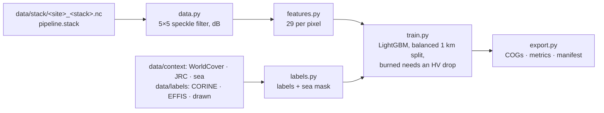

# ML model: per-pixel land classes

**Owner:** Luka Georgieski · Spec: [docs/MODELS.md → ML model](../../docs/MODELS.md#ml-model) · Data: [docs/DATA.md](../../docs/DATA.md)

Labels every pixel by how its NISAR L-band backscatter behaves through the season:
rice paddy · permanent water · urban · forest · burned · other crops and shrub · orchard.



## Run it

From the repo root, after the setup in the main README:

```bash
.venv\Scripts\python -m pip install -e ".[dev,ml]"
.venv\Scripts\python -m pytest tests/test_ml.py
```

Get the stacks (see [DATA.md](../../docs/DATA.md)), then one command per stack:

```bash
.venv\Scripts\python -m pipeline.ml run --site albufera --stack 066_D_069
.venv\Scripts\python -m pipeline.ml run --site espada --stack 058_A_022
```

No stack yet? Try the whole thing on a **fake** stack in the same format:

```bash
.venv\Scripts\python -m pipeline.ml synthetic
.venv\Scripts\python -m pipeline.ml run --site synthetic --stack 066_D_069 --truth-var truth
```

## Input: one shared stack

`data/stack/<site>_<stack>.nc` from `pipeline.stack`: HH and HV in linear power (NaN where not valid), `valid`, per-date `granule_ur`, `crid`, `maturity`, `pols`, on the site grid (`site_grid`, EPSG:32630, 20 m). `data.load` smooths each date with a 5×5 mean in linear power (`boxcar_power`, never mixing in invalid pixels; `--filter-px 0` turns it off), converts to dB and refuses a stack that is off its site grid. Tracks are never mixed: run each stack on its own.

- **HH-only date** (2026-09-22 on 058 A): HV is missing that day, but the date still counts for HH.
- **Newer processing release:** the last date (28 Oct, CRID P05036, VALIDATED) comes from a newer release. On stable urban pixels the step into it is only -0.10 to -0.34 dB in HH, inside normal 12-day changes ([DATA.md](../../docs/DATA.md)), so every date is kept by default. `--crid majority` leaves it out; dates left out are listed in `metrics.json`.

## Labels (`labels.py`)

Default files, used when they exist (later rows overwrite earlier ones):

| Priority | File | Gives |
|---|---|---|
| 1 | `data/context/<site>_worldcover_2021_20m.tif` | urban, other crops and shrub; tree cover is split with CORINE: **orchard** (221 to 223) or **forest** (311 to 313), unlabeled elsewhere |
| 2 | `data/context/<site>_jrc_occurrence_20m.tif` | permanent water at ≥ 90 %; seasonal water (1 to 89 %) left **unlabeled**, since it may be rice |
| 3 | `data/labels/<site>_clc2018.geojson` (CORINE 2018, `python -m pipeline.ml.corine`) | **rice paddy** from class 213, shrunk by 60 m so edges, paths and canals drop out; never over urban or permanent water |
| 4 | `data/labels/<site>_effis_burnt_area.geojson` | burned |
| 5 | `data/labels/<site>_drawn.geojson` (GeoJSON or GeoPackage, `class` column) | anything; Albufera has 50 hand-drawn rice fields, all inside CORINE rice |

**The sea** (`data/context/<site>_sea_20m.tif`: water joined to the east edge of the map, with canals cut first so the Albufera lagoon stays inland) is never a label and is not classified. It covers about 28 % of the Albufera grid.

What the committed files give today (20 m pixels):

| Site | rice | water | urban | forest | orchard | burned | other | sea (left out) |
|---|---:|---:|---:|---:|---:|---:|---:|---:|
| albufera | 361,107 | 55,706 | 166,360 | 10,182 | 145,438 | 0 | 443,236 | 496,999 |
| espada | 0 | 3,180 | 121,880 | 374,946 | 320,051 | 230,753 | 760,218 | 43,952 |

That is about 14,400 ha of rice at Albufera. Most Albufera "tree cover" is orange orchards: 72 % of it lies in CORINE fruit orchards (PR #7), so only the Devesa pines stay forest.

CORINE: © European Union, Copernicus Land Monitoring Service 2018, European Environment Agency (EEA). It is mapped at 1:100,000 from 2018 imagery, coarser than our 20 m grid.

## Features (`features.py`)

For HH and HV separately: mean, std, min, max, mean step between seen dates, the size and day of year of the biggest single drop and rise, and two **lasting change** features: late season minus early season, and the biggest drop of the mean after a date against the mean before it (with its date). Lasting change averages several dates, so speckle cancels; a fire shows up there, a single noisy date does not. Also the HV−HH ratio (mean, std, on dates with both), the share of HH dates darker than the water threshold, and the number of seen dates for HH and HV. Pixels seen on fewer than 3 dates in HH or HV are not classified.

The water threshold is Otsu over every HH value **with the sea** (without it there is no water mode and Otsu landed at -5 to -8 dB, among vegetation). If Otsu leaves -20 to -9 dB, a fixed -15 dB is used. The rule used is in `metrics.json`.

## Training and check (`train.py`, `split.py`)

- The map is cut into 1 km blocks; 25 % of blocks go to test, picked class by class (rarest first) so every class gets about a quarter of its labelled pixels in test and never less than half in train. Train pixels within 2 px of a test block are dropped, so neighbouring pixels (and the 5×5 filter) cannot leak.
- **Burned needs an HV drop:** a pixel may only be called burned if its HV fell by 1.0 dB or more and stayed down (`--burned-min-hv-drop`, 0 = off). Without a rule the first real run called 15,605 ha burned for a 9,230 ha fire. On espada 058_A_022: 1.5 dB gives burned precision 0.99 and recall 0.57; **1.0 dB gives 0.98 and 0.77**, so 1.0 is the default. Scores use the same rule as the map.
- At most 20,000 train pixels per class, with balanced class weights.
- Scores on the held-out blocks: overall accuracy, kappa, macro F1, per-class precision/recall/F1, confusion matrix.
- **What the scores mean:** the labels come from WorldCover, JRC, CORINE, EFFIS and the drawn fields, so every score is **agreement with those maps** on ground the model never saw, not accuracy against field visits. Say "agrees with CORINE rice 97 % of the time", not "97 % accurate". `metrics.json` carries the same note (`scores_are`).
- **Specks clean-up:** after the map is drawn, a 3×3 majority filter replaces a pixel when 5 or more of its 9 neighbours agree on another class (`--majority 1` turns it off). Then patches smaller than 5 pixels (0.2 ha) take the class of their largest neighbour (`--min-patch-px 1` turns it off). Nodata (sea, too few dates) is never filled in. Scores are taken from this final map, and `metrics.json` also keeps the scores from before the clean-up. At Espadà this took water from 766 patches to 122, with no single-pixel ones left.

## Outputs (`data/ml/<site>_<stack>/`)

| File | What |
|---|---|
| `class.tif` / `class_utm.tif` | Class index 0 to 6 (order in `config.CLASSES`), 255 = not classified (sea, too few dates), with a colormap. Web-optimized (EPSG:3857) / analysis grid (EPSG:32630) |
| `confidence.tif` / `confidence_utm.tif` | Highest class probability, 0 to 100 %, 255 = nodata |
| `metrics.json` | Scores, confusion matrix, label counts and sources, hectares per class (pixels × 0.04 ha), dates used and left out, split settings |
| `feature_importance.json` | LightGBM gain share per feature |
| `model.txt` | The trained LightGBM model. `lightgbm.Booster(model_file="model.txt").predict(X)` reuses it without training; columns follow `model_classes` in `metrics.json`, features follow `feature_names` |

A real (non-fake) run also adds `class` and `confidence` entries to `data/manifest.json`, with the source granule of every date. ML entries are keyed on (model, site, stack, layer), so a rerun replaces its own entry.

## Status

- [x] Reads the shared stack format; tested on a fake stack and on the real label files
- [x] Rice labels: CORINE 2018 rice plus 50 hand-drawn fields
- [x] First real run (Ilija, PR #7, before these fixes): Albufera accuracy 0.710, macro F1 0.733; Espadà 0.552, 0.421
- [x] Second real run (Ilija, PR #13, with these fixes): Albufera 0.798 / 0.773; Espadà 0.710 / 0.660 (agreement with the labels, accuracy / macro F1). Burned precision 0.99, rice F1 0.97
- [x] Third real run (our own stacks, built with `pipeline.nisar_fetch` + `pipeline.stack`; before the clean-up they reproduce Ilija's numbers exactly). Agreement with the labels on held-out 1 km blocks:

  | Stack | Accuracy | Macro F1 | Kappa | Notes |
  |---|---:|---:|---:|---|
  | albufera 066_D_069 | 0.807 | 0.791 | 0.742 | rice F1 0.97, water 0.99, urban 0.83, other 0.71, forest 0.66, orchard 0.58 |
  | espada 058_A_022 | 0.756 | 0.723 | 0.683 | burned P 0.98 / R 0.77 (6,846 ha, 6,447 inside EFFIS), forest 0.88 |

- [ ] Known weak spot: water at Espadà is over-mapped (308 ha mapped, 127 ha labelled, precision 0.37), mostly along reservoir margins where the shoreline moves through the season
- [ ] The second track of each site (albufera 058_A_021, espada 167_D_068) as a cross-check

<sub>SI disclosure: this code was drafted with an SI assistant (Claude Code) and reviewed by the team.</sub>
