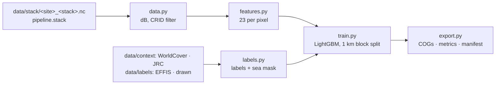

# ML model: per-pixel land classes

**Owner:** Luka Georgieski · Spec: [docs/MODELS.md → ML model](../../docs/MODELS.md#ml-model) · Data: [docs/DATA.md](../../docs/DATA.md)

Labels every pixel by how its NISAR L-band backscatter behaves through the season:
rice paddy · permanent water · urban · forest · burned · other crops and shrub.



## Run it

From the repo root, after the setup in the main README:

```bash
.venv\Scripts\python -m pip install -e ".[dev,ml]"
.venv\Scripts\python -m pytest tests/test_ml.py
```

Get the stacks (see [DATA.md](../../docs/DATA.md)), then one command per stack:

```bash
.venv\Scripts\python -m pipeline.ml run --site albufera --stack 066_D_069
.venv\Scripts\python -m pipeline.ml run --site espada --stack 058_A_022
```

No stack yet? Try the whole thing on a **fake** stack in the same format:

```bash
.venv\Scripts\python -m pipeline.ml synthetic
.venv\Scripts\python -m pipeline.ml run --site synthetic --stack 066_D_069 --truth-var truth
```

## Input: one shared stack

`data/stack/<site>_<stack>.nc` from `pipeline.stack`: HH and HV in linear power (NaN where not valid), `valid`, per-date `granule_ur`, `crid`, `maturity`, `pols`, on the site grid (`site_grid`, EPSG:32630, 20 m). `data.load` converts to dB and refuses a stack that is off its site grid. Tracks are never mixed: run each stack on its own.

- **HH-only date** (2026-09-22 on 058 A): HV is missing that day, but the date still counts for HH.
- **Newer processing release:** the last date (28 Oct, CRID P05036, VALIDATED) comes from a newer release. On stable urban pixels the step into it is only -0.10 to -0.34 dB in HH, inside normal 12-day changes ([DATA.md](../../docs/DATA.md)), so every date is kept by default. `--crid majority` leaves it out; dates left out are listed in `metrics.json`.

## Labels (`labels.py`)

Default files, used when they exist (later rows overwrite earlier ones):

| Priority | File | Gives |
|---|---|---|
| 1 | `data/context/<site>_worldcover_2021_20m.tif` | forest, urban, other crops and shrub |
| 2 | `data/context/<site>_jrc_occurrence_20m.tif` | permanent water at ≥ 90 %; seasonal water (1 to 89 %) left **unlabeled**, since it may be rice |
| 3 | `data/labels/<site>_effis_burnt_area.geojson` | burned |
| 4 | `data/labels/<site>_drawn.geojson` (GeoJSON or GeoPackage, `class` column) | anything, mainly **rice paddy** |

**The sea** (`data/context/<site>_sea_20m.tif`: water joined to the east edge of the map, with canals cut first so the Albufera lagoon stays inland) is never a label and is not classified. It covers about 28 % of the Albufera grid.

What the committed files give today (20 m pixels):

| Site | rice | water | urban | forest | burned | other | sea (left out) |
|---|---:|---:|---:|---:|---:|---:|---:|
| albufera | **0** | 55,716 | 166,360 | 201,987 | 0 | 549,446 | 496,999 |
| espada | **0** | 3,180 | 121,880 | 1,253,132 | 230,753 | 760,218 | 43,952 |

WorldCover has no rice class, so **rice needs the drawn polygons**. Without them the model cannot predict rice.

## Features (`features.py`)

For HH and HV separately: mean, std, min, max, mean step between seen dates, and the size and day of year of the biggest drop and rise. Also the HV−HH ratio (mean, std, on dates with both), the share of HH dates darker than the land-only Otsu water threshold, and the number of seen dates for HH and HV. Pixels seen on fewer than 3 dates in HH or HV are not classified.

## Training and check (`train.py`, `split.py`)

- The map is cut into 1 km blocks; 25 % of blocks go to test. Train pixels within 2 px of a test block are dropped, so neighbouring pixels cannot leak.
- At most 20,000 train pixels per class, with balanced class weights.
- Scores on the held-out blocks: overall accuracy, kappa, macro F1, per-class precision/recall/F1, confusion matrix.

## Outputs (`data/ml/<site>_<stack>/`)

| File | What |
|---|---|
| `class.tif` / `class_utm.tif` | Class index 0 to 5, 255 = not classified (sea, too few dates), with a colormap. Web-optimized (EPSG:3857) / analysis grid (EPSG:32630) |
| `confidence.tif` / `confidence_utm.tif` | Highest class probability, 0 to 100 %, 255 = nodata |
| `metrics.json` | Scores, confusion matrix, label counts and sources, hectares per class (pixels × 0.04 ha), dates used and left out, split settings |
| `feature_importance.json` | LightGBM gain share per feature |

A real (non-fake) run also adds `class` and `confidence` entries to `data/manifest.json`, with the source granule of every date.

## Status

- [x] Reads the shared stack format; tested on a fake stack and on the real Albufera label files
- [ ] Stacks: waiting for the `data-v1` release (or `python -m pipeline.run`)
- [ ] Rice polygons: `data/labels/albufera_drawn.geojson`
- [ ] Real metrics and maps for albufera 066_D_069 and espada 058_A_022

<sub>SI disclosure: this code was drafted with an SI assistant (Claude Code) and reviewed by the team.</sub>
